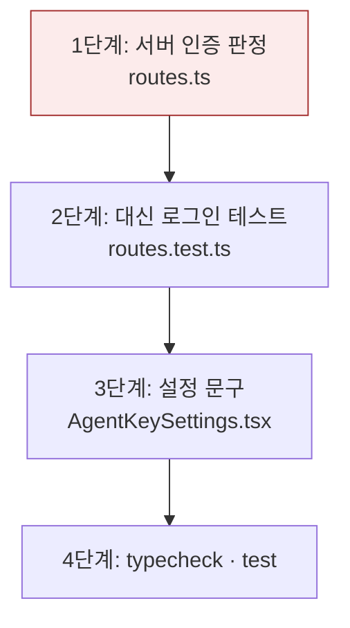

# Plan — 대신 로그인한 더미 계정의 에이전트 채팅 권한

## 바뀌는 파일

- 고침: `services/backend/src/modules/agent-chat/routes.ts`
- 고침: `services/backend/src/modules/agent-chat/routes.test.ts`
- 고침: `services/web/src/features/agent-chat/AgentKeySettings.tsx`

## 작업 순서

1. 라우트 판정을 principal 기준 함수로 바꾼다 — 세 자리 모두. 확인: `grep developer(` 결과 없음.
2. 라우트 테스트에 대신 로그인 경우를 더한다 — access `true`, messages 202, `send`에 키 없음.
3. 설정 문구를 고친다.
4. 검증.



## 가장 위험한 단계

1단계. 판정을 잘못 넓히면 일반 사용자가 서버 인증으로 채팅한다. 테스트의 일반 사용자 403 경우가 이를 잡는다. 되돌리기는 구현 커밋 revert.

## 검증

```bash
pnpm --filter @expresso/backend test -- src/modules/agent-chat/routes.test.ts
pnpm typecheck
```
