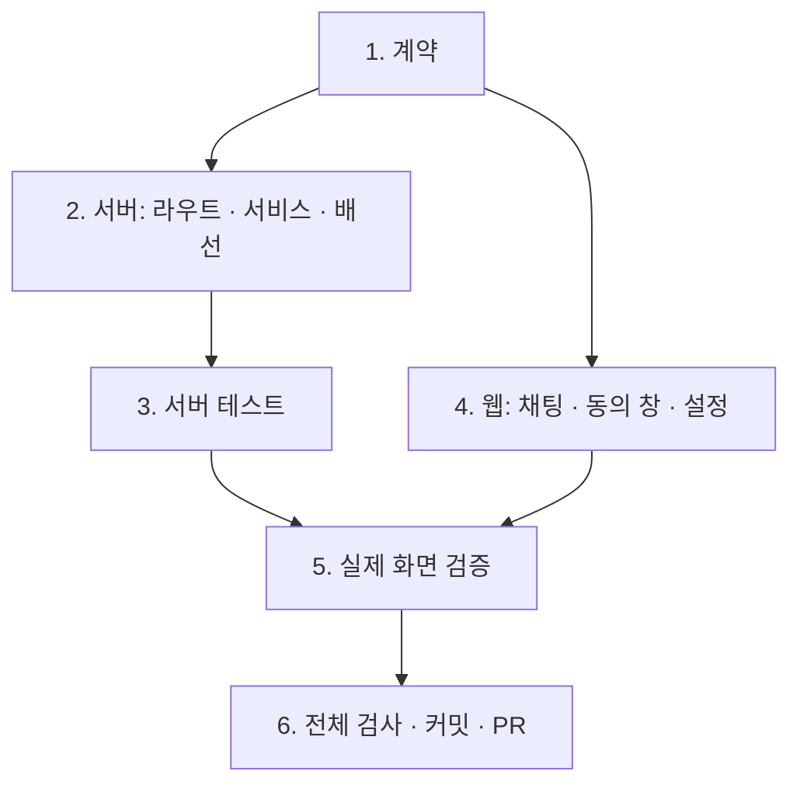

# 에이전트 채팅 전체 개방 — 구현 계획

## 바뀌는 파일

| 파일 | 무엇을 |
|---|---|
| `packages/contracts/src/agent-chat.ts` | `AgentChatAccessSchema`에서 `serverCredentialAllowed`를 빼고 `creditsExhausted`를 더함 |
| `services/backend/src/modules/agent-chat/routes.ts` | 개발 멤버 · 대신 로그인 판정 삭제, 키가 있으면 넘기고 없으면 서버 인증, `access`의 새 칸 |
| `services/backend/src/modules/agent-chat/service.ts` | 생성자에 `credits`, `prepare`의 크레딧 검사, `creditsExhausted` |
| `services/backend/src/api/main.ts` · `build-app.ts` | 서비스에 `entitlementService`를 넘기고 개발 멤버 목록 인자를 뺌 |
| `services/backend/src/config/runtime-config.ts` · `.env.example` | `AGENT_CHAT_DEVELOPER_USER_IDS` 삭제 |
| `services/backend/src/modules/agent-chat/routes.test.ts` · `service.integration.test.ts` | 새 접근 조건과 크레딧 검사 |
| `services/web/src/features/agent-chat/AgentChat.tsx` | 보내기 조건, 한도 안내, 키 요구 안내 삭제 |
| `services/web/src/features/agent-chat/AgentConsentDialog.tsx` | 키 등록 창 삭제 |
| `services/web/src/features/agent-chat/AgentKeySettings.tsx` | 모든 계정에 키 입력란과 선택 안내 |

구현 중 이 표에서 벗어나면 같은 커밋에서 이 파일을 고친다.

## 작업 순서



1. 계약 — `pnpm --filter @expresso/contracts test`.
2. 서버 — 타입 검사가 지나간다.
3. 서버 테스트 — 라우트 단위 테스트와 Mongo 통합 테스트.
4. 웹 — 타입 검사와 에이전트 채팅 테스트.
5. 실제 화면 — 복사본 DB에서 키 없는 일반 계정으로 홈에서 말을 보낸다.
6. 전체 검사 뒤 커밋 · 푸시 · PR.

## 가장 위험한 단계

2단계의 크레딧 검사다. 한도가 0으로 읽히면 모든 계정의 채팅이 막힌다. `credits`가 `remaining: null`(한도 없음)을 낼 때 막지 않는지, 한도가 남은 계정이 지나가는지를 통합 테스트로 본다. 되돌릴 때는 이 PR을 되돌리면 된다 — 마이그레이션이 없다.

## 검증

```
pnpm typecheck
pnpm test
pnpm test:infra
```

화면: 복사본 DB와 `AGENT_CHAT_ENABLED=1`로 띄운 서버에서 개인 키가 없는 일반 계정으로 `/home` → 말 보내기 → 답. `/account#ai-chat-settings`에서 키 입력란과 안내.
