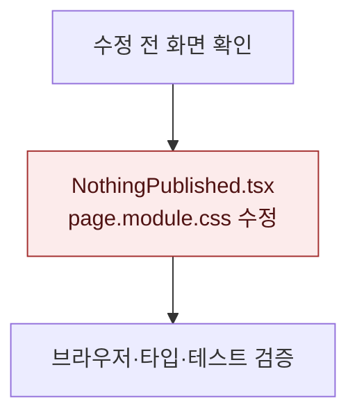

# 분석 빈 상태 본문 정렬 — 구현 계획

## 바뀌는 파일
| 파일 | 무엇을 |
|---|---|
| services/web/src/app/(app)/analytics/NothingPublished.tsx | 기존 content 본문 추가 |
| services/web/src/app/(app)/analytics/page.module.css | blank의 남는 공간 확장 |
| .sitrep/sessions/20261124-0318-chat-usability/* | 이전 사용성 개선의 후속 작업 기록 |

## 작업 순서
1. 수정 전 실제 분석 화면에서 치우침을 확인한다.
2. content 안에 blank를 배치하고 확장한다.
3. 실제 API·로그인 화면을 여러 크기와 Reduce Motion에서 확인한다.
4. 루트 타입 검사와 테스트를 실행하고 이전 작업 기록과 함께 커밋한다.

## 가장 위험한 단계
낮은 창의 세로 넘침. content에 스크롤을 맡기고 버튼까지 이동 가능한지 확인한다. 실패하면 해당 두 파일의 이번 변경만 되돌린다.

## 검증
pnpm typecheck
pnpm test
실제 로컬 분석 화면: 1440×940, 2560×1440, 768×1024, 375×812, 360×360 및 접힌 사이드바. 홈 이동과 분석 재진입 확인. Reduce Motion은 공용 CSS 규칙으로 확인하며 브라우저 미디어 에뮬레이션은 도구 미지원으로 생략.
