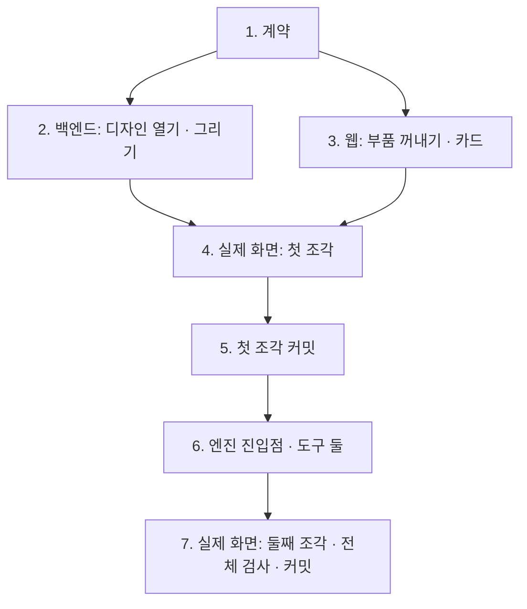

# 대화에서 디자인 고르기 — 구현 계획

## 바뀌는 파일

| 파일 | 무엇을 |
|---|---|
| `packages/contracts/src/agent-chat.ts` | `AgentBrewDesign`(카드), 그리기 입력, (둘째) 도구 입력 |
| `services/backend/src/modules/agent-chat/brew-start.ts` · `service.ts` · `routes.ts` | 디자인 열기 · 그리기 · 제작 열기의 디자인 단계 · 모델의 디자인 상태, (둘째) 도구 처리 |
| `services/backend/src/platform/agent/runtime.ts` | 상태의 `design`, 지침, (둘째) 도구 둘 |
| `services/backend/src/modules/page/design-chat/service.ts` · `prompts.ts` | (둘째) 엔진 진입점 `propose` · `revise`, 견본 제안 호출 |
| `services/backend/src/api/main.ts` · `modules/page/index.ts` · `modules/agent-chat/index.ts` | 배선, 디자인 대화 오류를 대화의 오류로(`DesignChatError` · `AgentChatError` 내보내기) |
| `services/web/src/features/design-chat/DesignChat.tsx` · `useDesignChat.ts` · `DesignChat.module.css` | 부품과 `useDesignView` 꺼내기, `autoOpen`, 화면 전체 무대 |
| `services/web/src/features/agent-chat/BrewDesignCard.tsx` · `.module.css` (새로) | 카드 |
| `services/web/src/app/api/brews/[brewId]/design-card/route.ts` · `lib/brew-design-card.ts` (새로) | 구성 · 생성 가능 여부 읽기 |
| `services/web/src/app/(app)/brew/[brewId]/design/failure-note.ts` (새로) · `page.tsx` | 실패 문장을 디자인 화면과 카드가 함께 씀 |
| `services/web/src/app/api/agent/[...path]/route.ts` | 디자인 열기 · 그리기 경로 통과 |
| `services/web/src/features/agent-chat/AgentChat.tsx` · `BrewInterviewCard.tsx` · `BrewStartCard.tsx` · `useAgentConversation.ts` | 카드 분기, 「디자인 고르기」, 스크롤, 잠금 |
| 테스트 | `service.integration.test.ts` · `runtime.test.ts` · 디자인 대화 테스트 · 카드 테스트 |

구현 중 이 표에서 벗어나면 같은 커밋에서 이 파일을 고친다.

## 작업 순서



## 가장 위험한 단계

3단계다. `DesignChat.tsx`의 상태를 꺼내는 동안 지금의 디자인 화면이 깨질 수 있다. 꺼낸 뒤 지금의 디자인 화면의 테스트와 실제 화면(견본 고르기 · 넓게 보기 · 고치기)을 다시 본다.

## 검증

```
pnpm typecheck
pnpm test
pnpm test:infra
```

화면: `http://brewchat.localhost:3197/jobs/<공고>?chat=<대화>`에서 「디자인 고르기」 → 견본 → 첫 화면 → 고르기 → 만들기. 지금의 디자인 화면 `/brew/<id>/design`도 함께 본다.
