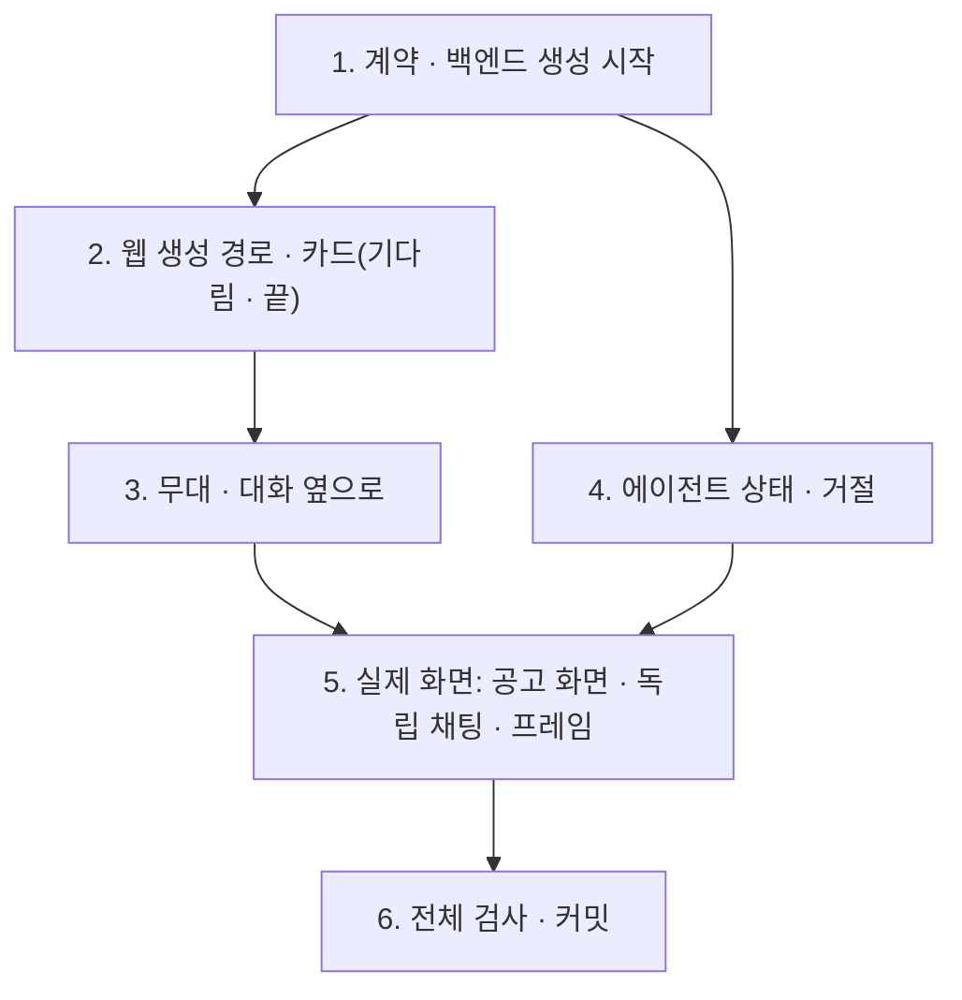

# 대화에서 포트폴리오 만들기 — 구현 계획

## 바뀌는 파일

| 파일 | 무엇을 |
|---|---|
| `packages/contracts/src/agent-chat.ts` | `AgentBrewGeneration`(카드) |
| `services/backend/src/modules/agent-chat/brew-start.ts` · `service.ts` · `routes.ts` | 생성 시작 · 카드, 모델의 생성 상태, 생성 중 디자인 거절 |
| `services/backend/src/platform/agent/runtime.ts` | 상태의 `generation`, 지침 |
| `services/backend/src/api/main.ts` | `startGeneration` 배선 |
| `services/web/src/app/(app)/brew/[brewId]/design/wait-reading.ts` (새로) · `page.tsx` | 입력 묶음 함수를 공용으로 |
| `services/web/src/app/api/brews/[brewId]/generation/route.ts` · `lib/brew-generation-card.ts` (새로) | 카드가 읽는 생성 상태 |
| `services/web/src/app/(app)/brew/[brewId]/design/LivePreview.tsx` | `onLive` · `onEnd` |
| `services/web/src/features/agent-chat/BrewGenerationCard.tsx` · `.module.css` (새로) | 카드 |
| `services/web/src/features/agent-chat/design-brews.tsx` · `BrewDesignCard.tsx` · `AgentChat.tsx` · `AgentChat.module.css` · `useAgentConversation.ts` | 제작별 생성 상태 · 무대 · 대화 옆으로 · 만들기 |
| `services/web/src/features/design-chat/DesignChat.tsx` | `MakeButton`이 주입한 만들기를 쓴다 |
| `services/web/src/app/(app)/jobs/[jobId]/JobChatRail.tsx` · `page.tsx` · `page.module.css` | 공고 화면의 무대 자리 |
| `services/web/src/app/api/agent/[...path]/route.ts` | 생성 시작 경로 통과 |
| 테스트 | `service.integration.test.ts` · `runtime.test.ts` · 카드 테스트 |

구현 중 이 표에서 벗어나면 같은 커밋에서 이 파일을 고친다.

## 작업 순서



## 가장 위험한 단계

3단계다. 공고 화면과 독립 채팅이 다른 자리에 무대를 두고, 화면 전환 효과가 레일의 폭 · 접힘과 얽힌다. 두 화면 모두 프레임을 찍어 움직임이 끊기지 않는지 본다. 확인마다 실제 생성(2분쯤, 이번 달 횟수)을 쓰므로 고른 첫 화면이 있는 제작을 미리 둘 마련한다.

## 검증

```
pnpm typecheck
pnpm test
pnpm test:infra
```

화면: `http://brewchat.localhost:3197/jobs/<공고>?chat=<대화>`와 `/agent?chat=<대화>`.
