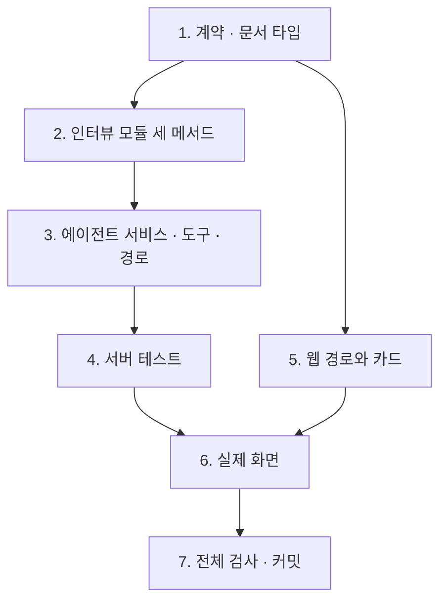

# 대화에서 AI 인터뷰 — 구현 계획

## 바뀌는 파일

| 파일 | 무엇을 |
|---|---|
| `packages/contracts/src/interview.ts` · `contracts.test.ts` | 세션 · 답 결과의 하한 0, 근거 키 `interviewBasisKey` |
| `packages/contracts/src/agent-chat.ts` | `AgentBrewInterview`(카드), 도구 입력 `AgentInterviewAnswerInput` |
| `packages/database/src/documents/agent-chat.ts` | `brewInterviews` · `brewInterviewMessages` |
| `services/backend/src/modules/interview/service.ts` · `index.ts` | `openConversation` · `conversationState` · `saveConversationAnswer` |
| `services/backend/src/modules/agent-chat/brew-start.ts` · `service.ts` · `routes.ts` | 인터뷰 열기, 저장 도구 처리, `serverEvent`, `openBrew`의 인터뷰 단계 |
| `services/backend/src/platform/agent/runtime.ts` | 새 도구, 상태의 `interview`, 지침 |
| `services/backend/src/api/main.ts` | 배선 |
| `services/web/src/lib/brew-interview-card.ts` (새로) · `brew-materials-card.ts` | 카드 데이터, 재료 카드의 잠금 판정 |
| `services/web/src/app/api/brews/[brewId]/interview/route.ts` (새로) · `materials/route.ts` | 카드 데이터 읽기, 재료 카드 데이터에서 질문 잡 칸 제거 |
| `services/web/src/app/api/agent/[...path]/route.ts` | 인터뷰 열기 경로(`POST brews/:brewId/interview`) 통과 |
| `services/web/src/features/agent-chat/BrewInterviewCard.tsx` · `.module.css` (새로) | 카드 |
| `services/web/src/features/agent-chat/BrewMaterialsCard.tsx` · `BrewStartCard.tsx` · `AgentChat.tsx` · `useAgentConversation.ts` | 시작 단추, 스크롤, 카드 분기 |
| 테스트 | `interview.integration.test.ts` · `service.integration.test.ts` · `runtime.test.ts` · `BrewMaterialsCard.test.tsx` · `BrewInterviewCard.test.tsx` (새로) · `brew-materials-card.test.ts` |

구현 중 이 표에서 벗어나면 같은 커밋에서 이 파일을 고친다.

## 작업 순서



1. 계약 · 문서 타입 — 빌드.
2. 인터뷰 모듈 — 통합 테스트(`pnpm test:infra`의 인터뷰 파일).
3. 에이전트 서비스 · 런타임 · 경로 · 배선 — 타입 검사.
4. 서버 테스트 — 대역 런타임으로 열기 · 다시 보내기 · 저장 도구.
5. 웹 — 타입 검사와 카드 테스트.
6. 실제 화면 — 복사본 DB(`expresso_brew_chat`), API 4197 · 웹 3197, 워커는 그대로(정리 작업).
7. 전체 검사 뒤 커밋 · 푸시.

## 가장 위험한 단계

3단계다. 서버가 시작한 실행이 하나 더 생기면 다시 보내기가 어느 계기로 다시 돌릴지, 카드 답변과 첫 질문 답변이 어떤 순서로 붙는지가 2단계의 재료 카드와 얽힌다. 카드 답변 뒤 첫 질문이 실패했을 때 다시 보내기가 첫 질문만 다시 만드는지를 테스트로 본다.

## 검증

```
pnpm typecheck
pnpm test
pnpm test:infra
```

화면: `http://brewchat.localhost:3197/jobs/<공고>?chat=<대화>`에서 재료 카드 → 「AI와 대화 시작」 → 첫 질문 → 답 → 「AI 대화」 카드 체크 → 「디자인 고르기」.
