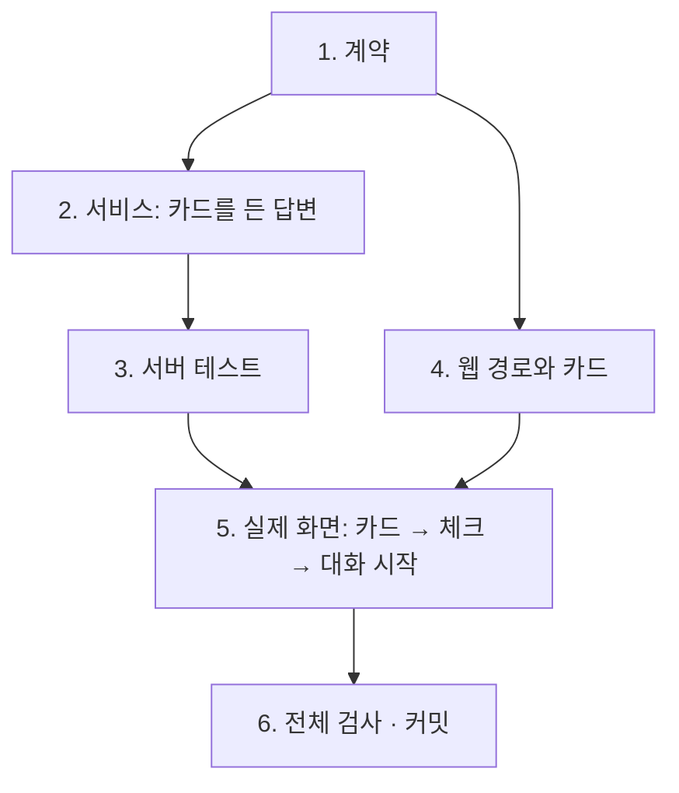

# 대화에서 재료 고르기 — 구현 계획

## 바뀌는 파일

| 파일 | 무엇을 |
|---|---|
| `packages/contracts/src/agent-chat.ts` | `AgentBrewMaterials`, 열기 응답(`path` 또는 `conversation`), 상태의 `step` |
| `services/backend/src/modules/agent-chat/brew-start.ts` | `brewState`(상태 + 고른 수), 단계 이름 |
| `services/backend/src/modules/agent-chat/service.ts` | `openBrew`가 재료 단계면 카드를 든 답변을 붙임, 모델에 넘기는 고른 수 |
| `services/backend/src/platform/agent/runtime.ts` | 모델에 넘기는 상태의 새 칸, 지침 |
| `services/backend/src/api/main.ts` | `brewState` 배선 |
| `services/web/src/app/api/brews/[brewId]/materials/route.ts` (새로) | 재료 읽기 · 저장 |
| `services/web/src/features/agent-chat/BrewMaterialsCard.tsx` · `.module.css` (새로) | 카드 |
| `services/web/src/features/agent-chat/BrewStartCard.tsx` · `AgentChat.tsx` · `useAgentConversation.ts` | 열기 결과 처리, 카드 분기 |
| 테스트 | `service.integration.test.ts` · `runtime.test.ts` · `BrewMaterialsCard.test.tsx` · `BrewStartCard.test.tsx` |

구현 중 이 표에서 벗어나면 같은 커밋에서 이 파일을 고친다.

## 작업 순서



1. 계약 — 빌드.
2. 서비스 — 타입 검사.
3. 서버 테스트 — 대역으로 한 번만 붙는 것과 단계별 갈래를 본다.
4. 웹 — 타입 검사와 카드 테스트.
5. 실제 화면 — 복사본 DB(`expresso_brew_chat`), 워커는 켜 둔다(질문 만들기가 큐 작업이다).
6. 전체 검사 뒤 커밋 · 푸시.

## 가장 위험한 단계

2단계다. 서버가 실행 없이 답변을 붙이면 「다시 보내기」와 알림이 보는 「마지막 두 메시지」의 모양이 달라진다. 실패한 답 뒤에 카드가 붙었을 때 다시 보내기가 엉뚱한 답변을 지우지 않는지를 테스트로 본다.

## 검증

```
pnpm typecheck
pnpm test
pnpm test:infra
```

화면: `http://brewchat.localhost:3197/jobs/<공고>?chat=<대화>`에서 「담을 기록 고르기」 → 「재료 고르기」 카드 → 체크 → 「AI와 대화 시작」.
