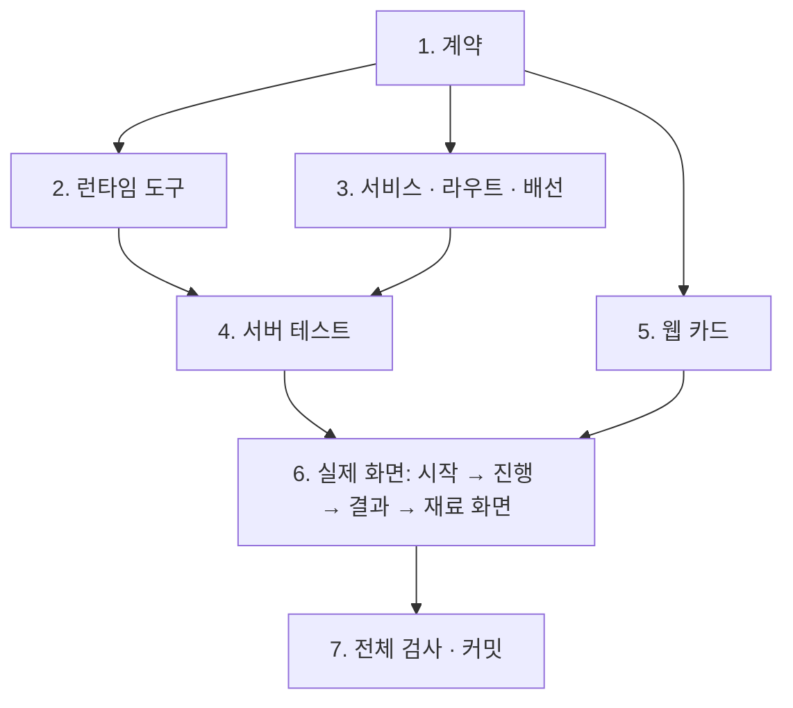

# 대화에서 포트폴리오 제작 시작과 공고 분석 — 구현 계획

## 바뀌는 파일

| 파일 | 무엇을 |
|---|---|
| `packages/contracts/src/agent-chat.ts` | `AgentBrewStart` · 입력 · 상태 · 열기 응답, `AgentToolResultSchema.brewStart` |
| `services/backend/src/platform/agent/runtime.ts` | 도구 `start_portfolio`, 지침 한 줄, 모델에 넘기는 `brews` |
| `services/backend/src/modules/agent-chat/brew-start.ts` (새로) | 상태 계산(확인 수), 줄 세우기 |
| `services/backend/src/modules/agent-chat/service.ts` | `startBrew` · `brewStartState` · `openBrew` · `retryBrewStart`, 실행 시작 때 상태 읽기 |
| `services/backend/src/modules/agent-chat/routes.ts` | `brew-starts` 경로 셋 |
| `services/backend/src/api/main.ts` | 서비스에 공고 · 분석 · 재료 서비스를 넘김 |
| `services/web/src/app/api/agent/[...path]/route.ts` | `brew-starts` 경로 통과 |
| `services/web/src/features/agent-chat/BrewStartCard.tsx` · `.module.css` (새로) | 카드 |
| `services/web/src/features/agent-chat/AgentChat.tsx` | 카드 분기, 도구 아이콘 |
| 테스트 | `runtime.test.ts` · `service.integration.test.ts`(상태 계산과 줄 세우기도 여기서 봄) · `BrewStartCard.test.tsx` |

구현 중 이 표에서 벗어나면 같은 커밋에서 이 파일을 고친다.

## 작업 순서



1. 계약 — 계약 테스트.
2. 런타임 도구 — 런타임 테스트.
3. 서비스 · 라우트 · 배선 — 타입 검사.
4. 서버 테스트 — 대역으로 한 번만 만들기와 거절을 본다.
5. 웹 카드 — 타입 검사.
6. 실제 화면 — 복사본 DB(`expresso_brew_chat`), AI를 켠 워커, 실제 Claude 호출.
7. 전체 검사 뒤 커밋 · 푸시.

## 가장 위험한 단계

3단계의 「한 번만」이다. `createBrew`는 같은 분석으로 여러 번 부르면 제작을 여러 개 만든다. `open`이 두 번 겹치거나 다시 보내기로 카드가 새로 생겼을 때 제작이 둘이 되지 않는지를 테스트로 본다. 되돌릴 때는 이 브랜치의 커밋을 되돌리면 된다 — 마이그레이션이 없다.

## 검증

```
pnpm typecheck
pnpm test
pnpm test:infra
```

화면: `http://brewchat.localhost:3197/jobs/<공고>`의 채팅 레일에서 "이 공고로 포트폴리오 만들어 줘" → 카드의 진행 → 결과 → 「담을 기록 고르기」 → `/brew/<id>/materials`.
