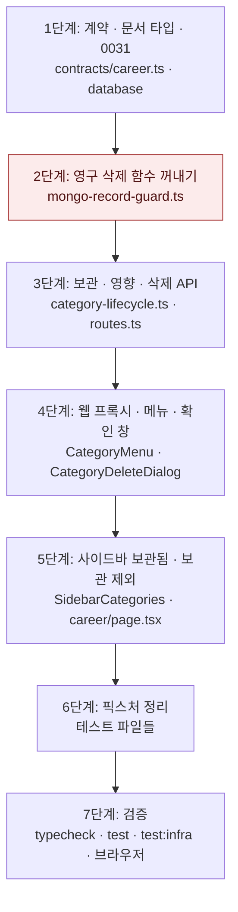

# 커리어 카테고리 보관 · 삭제 — 구현 계획

## 바뀌는 파일

| 파일 | 무엇을 |
|---|---|
| `packages/contracts/src/career.ts` | 카테고리 `archivedAt` · `builtIn`, 보관 · 삭제 · 영향 스키마 (고침) |
| `packages/database/src/documents/career.ts` | `CareerCategoryDoc.archivedAt?` (고침) |
| `packages/database/src/mongodb-migrations/0031/migration.ts` | `career_categories.archivedAt` 검증 규칙 (새로) |
| `packages/database/src/mongo-migrations.ts` | 0031 등록 (고침) |
| `services/backend/src/modules/career/mongo-record-guard.ts` | `purgeCareerRecordInTransaction` 꺼냄 (고침) |
| `services/backend/src/modules/career/category-lifecycle.ts` | 보관 · 영향 · 삭제 (새로) |
| `services/backend/src/modules/career/mongo-categories.ts` | `mapMongoCategory`가 `archivedAt` · `builtIn`을 채움 (고침) |
| `services/backend/src/modules/career/service.ts` · `routes.ts` | 위임 메서드와 라우트 3개 (고침) |
| `services/backend/src/modules/career/category-lifecycle.integration.test.ts` | 통합 테스트 (새로) |
| `services/web/src/app/api/career/categories/[categoryId]/route.ts` · `delete-impact/route.ts` | 프록시 (새로) |
| `services/web/src/features/career-editor/views/CategoryMenu.tsx` · `CategoryDeleteDialog.tsx` | 메뉴 항목과 확인 창 (고침 · 새로) |
| `services/web/src/app/(app)/career/[categorySlug]/CareerBrowser.tsx` | 메뉴에 카테고리 전달, 「보관됨」 표시 (고침) |
| `services/web/src/components/shell/SidebarCategories.tsx` · `Sidebar.module.css` | 보관됨 묶음 (고침) |
| `services/web/src/app/(app)/career/page.tsx`, `MoveCategoryDialog.tsx`, `PropertyCreatePopover.tsx` | 보관 카테고리 제외 (고침) |
| 카테고리 픽스처가 있는 테스트들 | `archivedAt: null` · `builtIn` 추가 (고침) |

## 작업 순서

1. 계약 · 문서 타입 · 마이그레이션 0031 — `pnpm --filter @expresso/contracts build`와 database 빌드 통과.
2. `purgeCareerRecordInTransaction` 꺼내기 — 기존 `trash-retention.integration.test.ts` 통과.
3. `category-lifecycle.ts` · 서비스 · 라우트 · 매퍼 — 새 통합 테스트 통과.
4. 웹 프록시 · 메뉴 · 확인 창 · 사이드바 · 보관 제외 — 웹 단위 테스트 추가 · 통과.
5. 픽스처 정리 — `pnpm typecheck` 통과.
6. 검증 — 아래 명령과 브라우저 확인.



## 가장 위험한 단계

2단계. 휴지통 만료 정리(스케줄러)가 쓰는 영구 삭제 절차를 고치므로, 조건 검사를 잘못 옮기면 보관 기간이 남은 기록까지 지워진다. 기존 함수의 조건(`deletedAt ≠ null`, `purgeAfter ≤ at`)은 바깥 함수에 그대로 두고 본문만 옮긴다. `trash-retention.integration.test.ts`가 깨지면 그 커밋을 되돌린다.

## 검증

```
pnpm typecheck
pnpm test
pnpm test:infra
```

브라우저(워크트리 전용 포트, `<이름>.localhost`, 복사본 DB): 직접 만든 빈 카테고리 삭제 · 기록 3개 카테고리 「기록까지 삭제」와 「대신 보관」 · 기본 「학력」 보관 → 「보관됨」 → 보관 해제 · 인용 중 카테고리의 막힘 안내.
