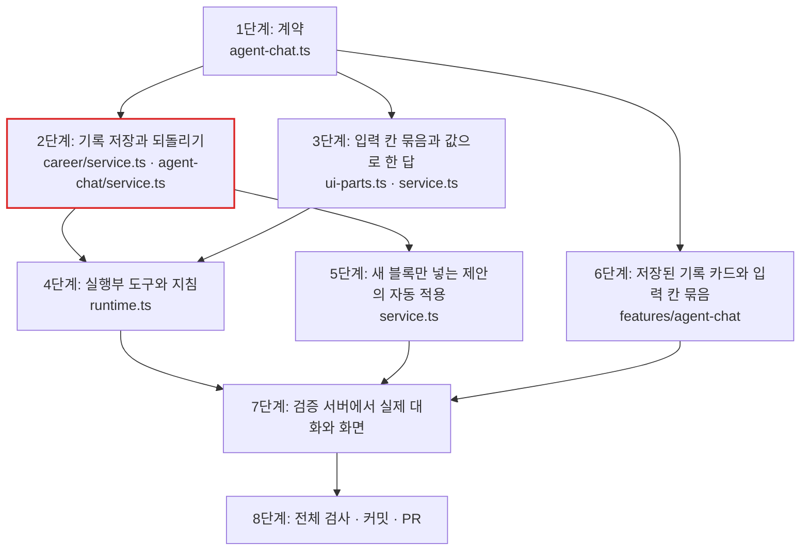

# 대화로 기록 — 인터뷰와 자동 저장 — 구현 계획

## 바뀌는 파일

| 파일 | 무엇을 |
|---|---|
| `packages/contracts/src/agent-chat.ts` · `agent-chat.test.ts` | 저장된 기록(`AgentSavedRecordSchema`), 입력 칸 묶음 부품과 도구 입력, `reply`의 두 모양, 도구 결과의 `savedRecord` |
| `services/backend/src/modules/career/service.ts` | `createRecord`의 선택 인자(상태 · 출처) |
| `services/backend/src/modules/agent-chat/ui-parts.ts` · `ui-parts.test.ts` | 입력 칸 묶음 만들기, 값으로 한 답 확인 |
| `services/backend/src/modules/agent-chat/record-draft.ts` | 저장 입력의 카테고리 확인 |
| `services/backend/src/modules/agent-chat/service.ts` · `routes.ts` · `digest.ts` · 테스트 | 기록 저장 · 되돌리기, 카테고리 싣기, 값으로 한 답, 새 블록만 넣는 제안의 자동 적용, 요지에 저장한 기록 |
| `services/backend/src/platform/agent/runtime.ts` · `runtime.test.ts` | `save_record` · `ask_form` 도구, `propose_new_record` 제거, 인터뷰와 저장 지침, `recordCategories` |
| `services/web/src/features/agent-chat/` (`SavedRecordCard.tsx` · `FormPart.tsx` 새 파일과 스타일 · 테스트, `tool-parts.tsx`, `useAgentConversation.ts`, `AgentChat.tsx`) | 저장된 기록 카드, 입력 칸 묶음, 등록표 항목, 되돌리기 요청 |
| `services/web/src/app/api/agent/[...path]/route.ts` | 되돌리기 경로 |

구현 중 이 표에서 벗어나면 같은 커밋에서 이 파일을 고친다.

## 작업 순서



## 가장 위험한 단계

2단계다. 승인 없이 사용자의 커리어 기록이 생긴다. 말하지 않은 내용이 기록으로 들어가면 포트폴리오까지 간다. 출처 인용 검사(지금의 `draftIssues`)를 저장 경로에서도 반드시 지나게 하고, 말하지 않은 인용이 든 저장이 기록을 만들지 않는 것을 통합 테스트로 본다. 되돌릴 때는 PR을 되돌린다. 그 사이 자동 저장된 기록은 출처가 `ai`이고 상태가 `organized`라 목록에서 가려낼 수 있다.

## 검증

```
pnpm typecheck
pnpm test
pnpm test:infra
```
