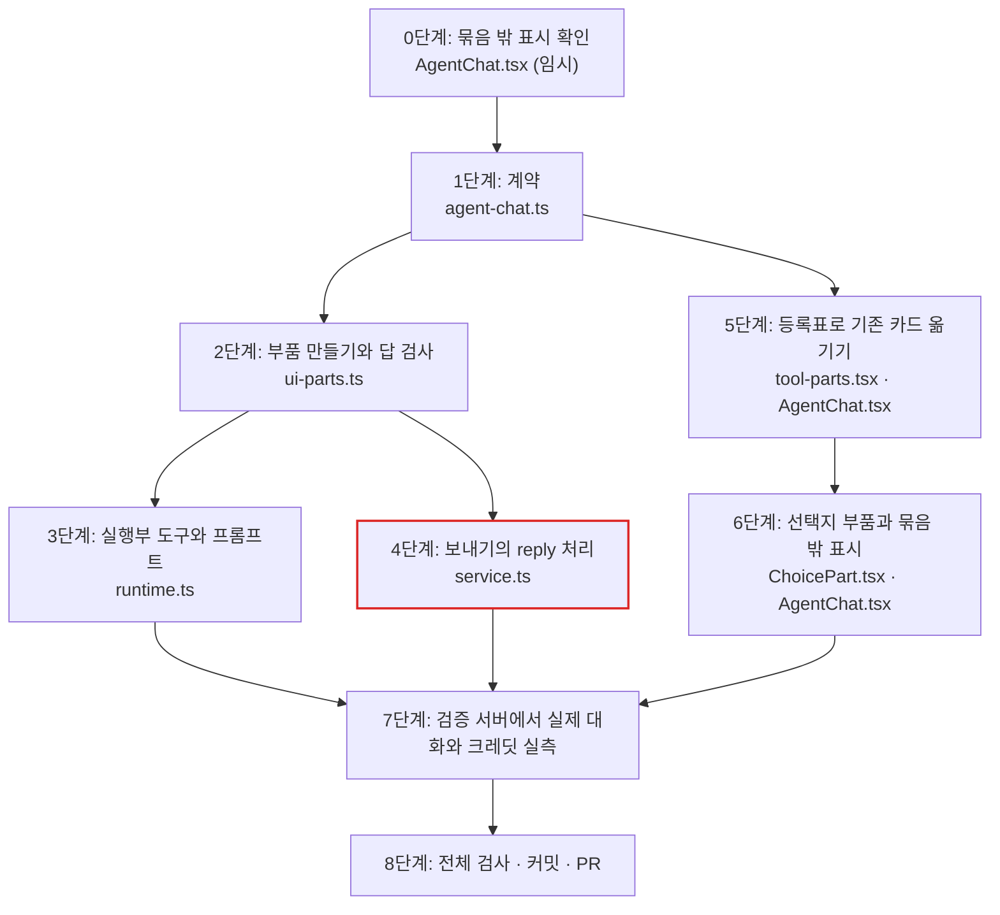

# 대화 속 화면의 토대와 선택지 부품 — 구현 계획

## 바뀌는 파일

| 파일 | 무엇을 |
|---|---|
| `packages/contracts/src/agent-chat.ts` · `agent-chat.test.ts` | 부품 계약(`AgentUiPartSchema`, 선택지), 도구 입력(`AgentChoiceInputSchema`), 도구 결과의 `ui`, 사용자 메시지의 `reply`, 보내기의 `reply` |
| `services/backend/src/platform/agent/runtime.ts` · `runtime.test.ts` | `ask_choice` 도구, 이름표, 한 실행 한 번 제한, 시스템 프롬프트의 선택지 지침, 모델에 넘기는 대화에 부품과 답 |
| `services/backend/src/modules/agent-chat/ui-parts.ts` (새 파일) · `ui-parts.test.ts` | 부품 만들기(id 붙이기 · 겹치는 글 검사), 답 검사(순수 함수) |
| `services/backend/src/modules/agent-chat/service.ts` · `service.integration.test.ts` | 실행에 `askChoice` 연결, 보내기의 `reply` 처리 |
| `services/web/src/features/agent-chat/tool-parts.tsx` (새 파일) · `tool-parts.test.tsx` | 등록표, 기존 카드 일곱 종 옮기기 |
| `services/web/src/features/agent-chat/ChoicePart.tsx` · `ChoicePart.module.css` · `ChoicePart.test.tsx` (새 파일) | 선택지 부품 |
| `services/web/src/features/agent-chat/AgentChat.tsx` | `RecordTool`이 등록표를 부름, 부품이 있는 도구 호출을 글 뒤에 두기, 선택지 도구 UI를 묶음 밖 표시로 등록 |
| `services/web/src/features/agent-chat/useAgentConversation.ts` | `answerPart(partId, optionIds)` |

구현 중 이 표에서 벗어나면 같은 커밋에서 이 파일을 고친다.

## 작업 순서



0. 묶음 밖 표시 — 지금 있는 도구 이름에 임시 UI를 `display: "standalone"`으로 등록해, 이 저장소의 실행 방식(`useExternalStoreRuntime`)에서 작업 흔적 밖에 그려지는지 테스트로 확인한다. 안 되면 선택지 부품을 답변 아래의 별도 자리에 그리는 방식으로 명세를 고친다.
1. 계약 — `pnpm --filter @expresso/contracts test`.
2. 부품 만들기와 답 검사 — 순수 함수 단위 테스트.
3. 실행부 — 실행부 테스트.
4. 보내기 — Mongo 통합 테스트.
5. 등록표 — 웹 테스트. 기존 카드 테스트가 그대로 통과한다.
6. 선택지 부품 — 웹 테스트.
7. 실제 대화 — 검증 서버와 별도 DB.
8. 전체 검사 뒤 커밋 · 푸시 · PR.

## 가장 위험한 단계

4단계다. 보내기는 모든 대화가 지나는 길이다. `reply` 처리가 보통의 보내기를 막거나, 부품의 `answer`를 다른 도구 결과에 쓰면 대화가 계약 검증에 걸려 읽히지 않는다. `reply`가 있는 보내기는 메시지 배열 전체를 새로 쓴다. `reply`가 없는 보내기가 변경 전과 같은 문서를 만드는지, `answer`가 맞는 부품에만 들어가는지, 다시 도착한 같은 요청이 409가 아닌지를 통합 테스트로 본다. 이 테스트를 구현보다 먼저 쓴다. 마이그레이션이 없으므로 되돌릴 때는 이 PR을 되돌린다. 되돌린 뒤에도 `ui`와 `reply` 칸이 든 대화가 남으면 옛 계약(strict)이 그 대화를 읽지 못하므로, 병합 전에는 운영 DB에 이 칸이 생기지 않는다는 점을 PR에 적는다.

## 검증

```
pnpm typecheck
pnpm test
pnpm test:infra
```
