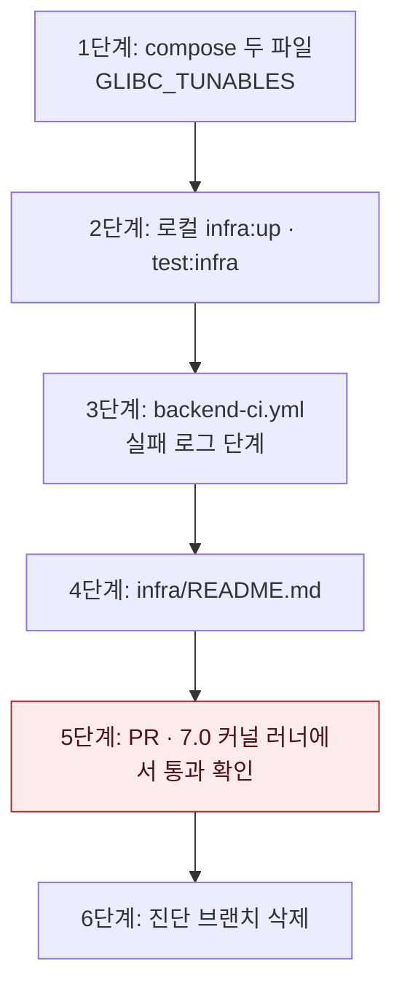

# 새 리눅스 커널에서 MongoDB가 뜨지 않아 백엔드 CI가 실패하는 문제 — 구현 계획

## 바뀌는 파일

| 파일 | 무엇을 |
|---|---|
| `infra/compose.mongodb.yaml` | `mongodb` 서비스에 `GLIBC_TUNABLES`와 근거 주석 |
| `infra/compose.yaml` | 같은 설정 |
| `.github/workflows/backend-ci.yml` | 실패하면 `mongodb` 로그를 찍는 단계 |
| `infra/README.md` | 커널 6.19~7.0.13 문제와 이 설정이 있는 이유 한 단락 |

구현 중 이 표에서 벗어나면 같은 커밋에서 이 파일을 고친다.

## 작업 순서

1. 두 compose 파일에 설정을 넣는다. — `docker compose config`로 `mongodb`에만 들어간 것을 본다.
2. 로컬에서 `pnpm infra:up` 뒤 `pnpm test:infra`. — 통과.
3. CI에 실패 로그 단계를 넣는다.
4. `infra/README.md`에 한 단락.
5. PR을 열고 CI를 돌린다. — 실행의 러너 커널을 확인한다. 6.x에 걸렸으면 다시 돌려 7.0 커널에서 통과하는 것을 본다.
6. 진단 브랜치 `diag/ci-mongodb-logs`를 지운다.



## 가장 위험한 단계

5단계다. 7.0 커널 러너는 무작위로 배정되므로 PR 실행이 6.x 러너에 걸리면 통과해도 이 수정을 확인한 것이 아니다. 실행 로그에서 커널을 확인하고, 7.0에서 통과할 때까지 다시 돌린다. 진단 실행에서는 7.0 러너가 실행의 30~50%였다.

로컬(2단계)의 위험은 낮다. 이 설정은 기존 컨테이너를 다시 만들게 하지만 데이터 볼륨은 그대로다.

## 검증

```
pnpm infra:up
pnpm test:infra
```

CI — 이 PR의 `verify`가 커널 7.0 러너에서 통과하는 실행 하나.
