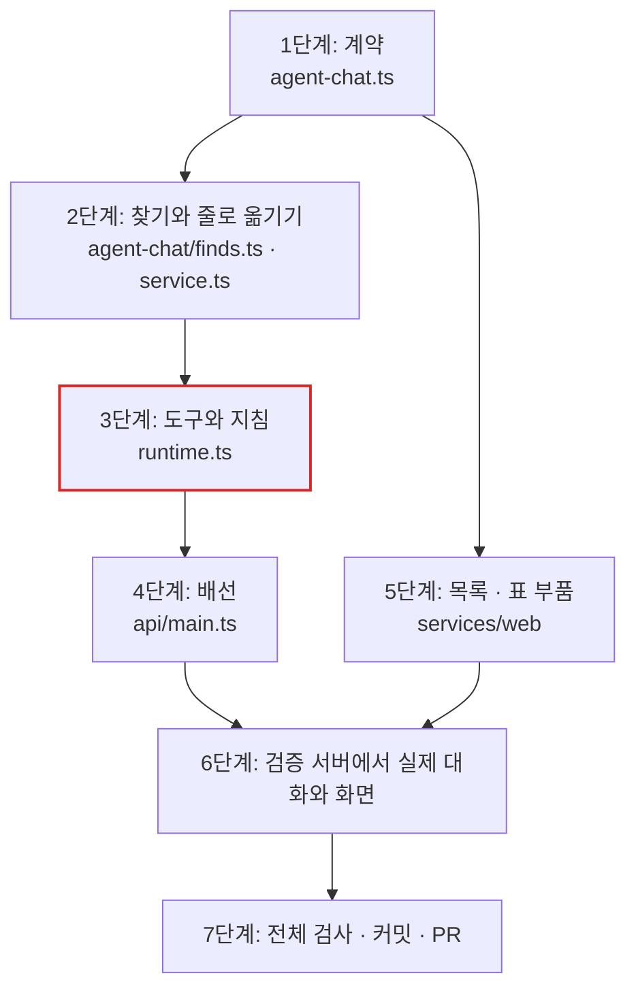

# 행동 제안 — 구현 계획

## 바뀌는 파일

| 파일 | 무엇을 |
|---|---|
| `packages/contracts/src/agent-chat.ts` · 테스트 | 찾기 도구의 입력, 목록 · 표 부품, 도구 결과의 `list` · `table` |
| `services/backend/src/modules/agent-chat/service.ts` · `finds.ts` 새 파일 · 테스트 | 공고 · 활동 찾기, 줄로 옮기기, 넘긴 대상 빼기 |
| `services/backend/src/modules/proposals/service.ts` | 넘긴 대상의 키 읽기 |
| `services/backend/src/platform/agent/runtime.ts` · `runtime.test.ts` | `search_jobs` · `search_activities` · `show_table` 도구와 지침 |
| `services/backend/src/api/main.ts` | 배선 |
| `services/web/src/features/agent-chat/` (`ListPart.tsx` · `TablePart.tsx` 새 파일 · `tool-parts.tsx` · `AgentChat.tsx` · `DiagnosisCard.tsx` · 테스트) | 목록 부품, 표 부품, 진단 카드의 경력 연차 줄 |

구현 중 이 표에서 벗어나면 같은 커밋에서 이 파일을 고친다.

## 작업 순서



## 가장 위험한 단계

3단계다. 도구가 셋 늘면 실행마다 읽는 도구 설명이 늘고, 찾기 결과가 문맥에 쌓여 크레딧이 는다. 도구 설명과 돌려주는 결과를 짧게 두고, 한 실행의 찾기 횟수에 상한을 둔다. 실제 대화의 크레딧을 실측해 PR에 적는다. 되돌릴 때는 PR을 되돌린다 — 새 저장이 없다.

## 검증

```
pnpm typecheck
pnpm test
pnpm test:infra
```
