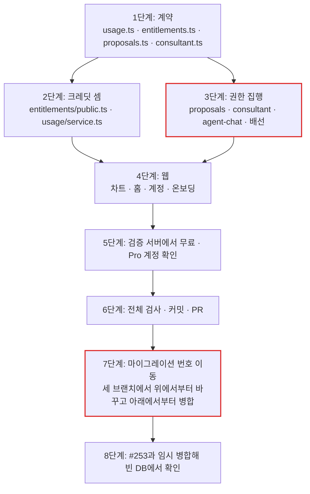

# 크레딧 계산과 먼저 연락하기의 요금제 — 구현 계획

## 바뀌는 파일

| 파일 | 무엇을 |
|---|---|
| `packages/contracts/src/usage.ts` · 테스트 | 무게 표, `creditsFromUsage`, `billableTokens`, 제외 계약 |
| `packages/contracts/src/entitlements.ts` · `proposals.ts` · `consultant.ts` | 권한 `consultant.outreach`, `plan_required`, `available` |
| `services/backend/src/modules/entitlements/` (`public.ts` · `service.ts` · `index.ts` · 테스트) | 종류별 합계, 권한 표 |
| `services/backend/src/modules/usage/service.ts` · 테스트 | 같은 셈, 제외 계약 |
| `services/backend/src/modules/proposals/service.ts` · 테스트 | 권한 확인, 크레딧 확인 제거 |
| `services/backend/src/modules/consultant/` (`routes.ts` · `commitments.ts` · 테스트) | 켜기 403, 확인 읽기와 확인 작업의 권한 |
| `services/backend/src/modules/agent-chat/service.ts` · `platform/agent/runtime.ts` · 테스트 | 기억의 `checkins`, 지침 |
| `services/backend/src/api/main.ts` · `api/build-app.ts` · `worker/main.ts` · `modules/scheduling/` | 배선 |
| `services/web/src/app/(app)/home/` (`ProposalFeed.tsx` · `CheckinFeed.tsx` · 테스트) | 잠긴 상태 |
| `services/web/src/app/(app)/account/` (`page.tsx` · `UsageCharts.tsx`) · `lib/usage-copy.ts` · 테스트 | 먼저 연락받기 줄, 차트, 기능 이름 |
| `services/web/src/app/(auth)/onboarding/consent/page.tsx` · `app/consent-actions.ts` | 항목 제거 |
| `feat/consultant-memory` · `feat/consultant-follow-up` · `feat/consultant-diagnosis`의 `packages/database/src/mongodb-migrations/` 와 등록 목록 | 번호 이동(그 브랜치에서 커밋하고 위로 병합) |

구현 중 이 표에서 벗어나면 같은 커밋에서 이 파일을 고친다.

## 작업 순서



## 가장 위험한 단계

3단계와 7단계다.

3단계는 집행할 자리가 여럿이다(켜기, 다시 받기, 실행, 줄 넣기, 읽기, 확인 작업). 한 곳이라도 빠지면 무료 계정에 크레딧 없이 AI가 돈다. 판단 함수를 하나로 두고, 자리마다 권한 없는 사용자의 테스트를 둔다.

7단계는 푸시된 브랜치 여섯 개를 건드린다. 번호가 바뀐 브랜치를 위로 병합할 때 같은 번호의 폴더가 서로 다른 컬렉션을 가리켜 충돌한다. 위쪽 브랜치의 번호를 먼저 바꾼 뒤 아래에서부터 병합하고, 병합마다 폴더와 컬렉션이 맞는지 확인한다. 강제 푸시와 리베이스는 하지 않는다. 되돌릴 때는 그 커밋을 되돌린다.

## 검증

```
pnpm typecheck
pnpm test
pnpm test:infra
```
