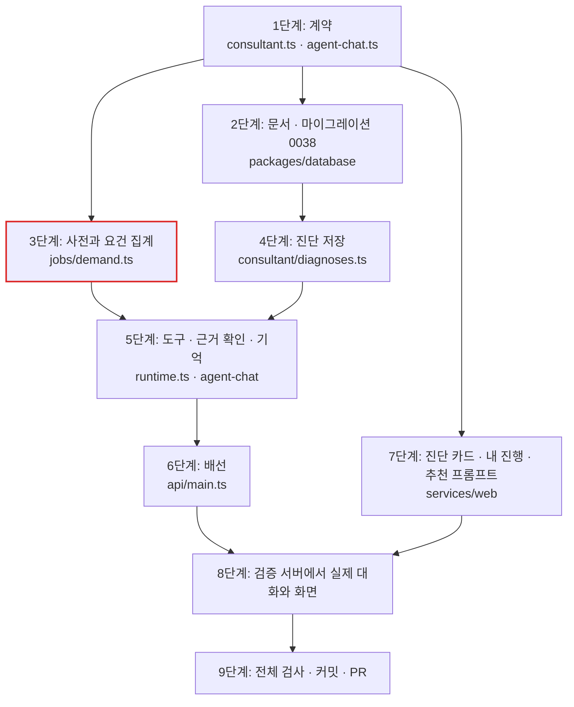

# 진단 — 목표가 요구하는 것과 내 기록의 대조 — 구현 계획

## 바뀌는 파일

| 파일 | 무엇을 |
|---|---|
| `packages/contracts/src/consultant.ts` · `agent-chat.ts` · 테스트 | 요건 집계, 진단, 도구 입력, 도구 결과의 `diagnosis` |
| `packages/database/src/documents/consultant.ts` · `collections.ts` · `mongodb-migrations/0038/migration.ts` · `mongo-migrations.ts` · `mongo-build.mjs` · 테스트 | 진단 문서와 컬렉션, 마이그레이션 0038 |
| `services/backend/src/modules/jobs/demand.ts` 새 파일 · `index.ts` · 테스트 | 사전과 요건 집계 |
| `services/backend/src/modules/consultant/diagnoses.ts` 새 파일 · `routes.ts` · `index.ts` · 테스트 | 진단 저장과 읽기, 기억 응답 |
| `services/backend/src/modules/agent-chat/service.ts` · `digest.ts` · `record-draft.ts` · 테스트 | 도구 연결, 근거 확인, 기억의 진단 요약, 기존 기록에 더하기 |
| `services/backend/src/platform/agent/runtime.ts` · `runtime.test.ts` | `read_goal_demand` · `record_diagnosis` · `append_to_record` 도구와 지침 |
| `services/backend/src/api/main.ts` · `build-app.ts` · `modules/account-lifecycle/mongo-purge.ts` | 배선, 삭제 목록 |
| `services/web/src/features/agent-chat/` (`DiagnosisCard.tsx` 새 파일 · `tool-parts.tsx` · 테스트) | 진단 카드 |
| `services/web/src/app/(app)/goal/` · `home/HomeStart.tsx` | 내 진행의 진단, 추천 프롬프트 |

구현 중 이 표에서 벗어나면 같은 커밋에서 이 파일을 고친다.

## 작업 순서



## 가장 위험한 단계

3단계다. 사전으로 원문에서 요건을 세면 잘못 세기 쉽다 — `go`가 영어 문장에서 잡히거나, 「경험」 표현이 우대 사항이 아닌 회사 소개에서 잡힌다. 실제 공고 데이터(로컬 개발 DB의 공고를 검증 DB로 복사)로 직군별 결과를 뽑아 눈으로 확인하고, 틀리게 잡히는 표현을 사전에서 고친 뒤 다음 단계로 간다. 되돌릴 때는 PR을 되돌린다.

## 검증

```
pnpm typecheck
pnpm test
pnpm test:infra
```
