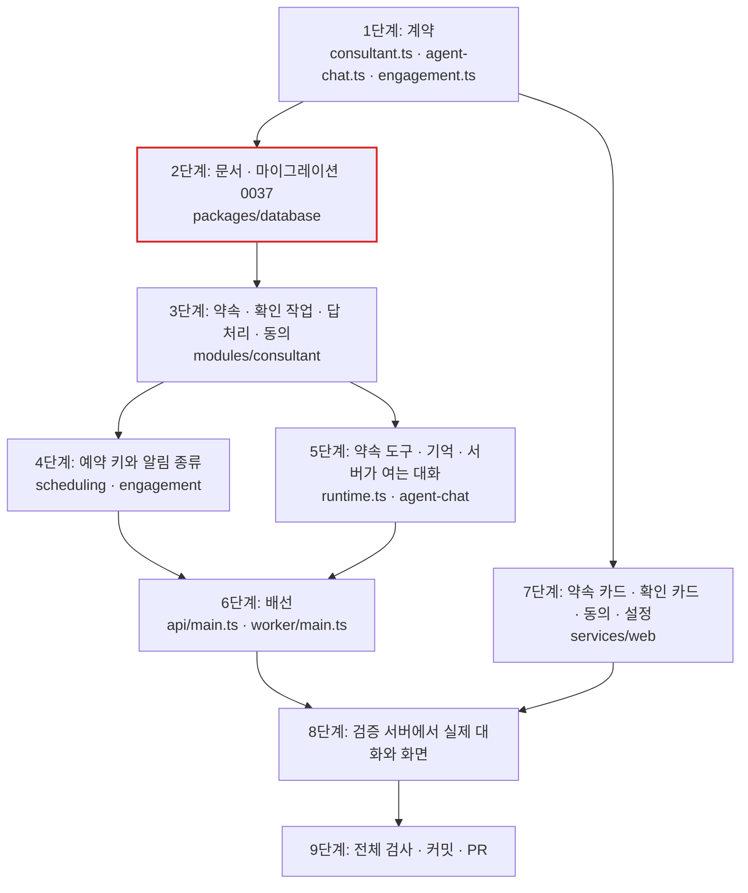

# 챙기기 — 약속과 먼저 연락하기 — 구현 계획

## 바뀌는 파일

| 파일 | 무엇을 |
|---|---|
| `packages/contracts/src/consultant.ts` · `agent-chat.ts` · `engagement.ts` · 테스트 | 약속 · 확인 · 동의, 도구 입력, 날짜 칸, 알림 종류 `consultant` |
| `packages/database/src/documents/consultant.ts` · `analytics.ts` · `operations.ts` · `collections.ts` · `mongodb-migrations/0037/migration.ts` · `mongo-migrations.ts` · `mongo-build.mjs` · 테스트 | 약속 문서와 컬렉션, 마이그레이션 0037 |
| `services/backend/src/modules/consultant/` (`commitments.ts` 새 파일 · `service.ts` · `routes.ts` · `index.ts` · 테스트) | 약속, 확인 작업, 답 처리, 동의, 라우트 |
| `services/backend/src/modules/scheduling/public.ts` · `service.ts` · 테스트 | 키 `consultant_checkins` |
| `services/backend/src/modules/engagement/service.ts` | 알림 종류 목록 |
| `services/backend/src/modules/agent-chat/service.ts` · `index.ts` · `digest.ts` · `ui-parts.ts` · 테스트 | 약속 도구 연결, 기억에 약속, 서버가 여는 대화, 날짜 칸 확인 |
| `services/backend/src/platform/agent/runtime.ts` · `runtime.test.ts` | `make_commitment` · `update_commitment` 도구와 지침 |
| `services/backend/src/api/main.ts` · `build-app.ts` · `worker/main.ts` · `modules/account-lifecycle/mongo-purge.ts` | 배선, 삭제 목록 |
| `services/web/src/features/agent-chat/` (`CommitmentCard.tsx` 새 파일 · `FormPart.tsx` · `tool-parts.tsx` · 테스트) · `app/api/consultant/commitments/[id]/route.ts` 새 파일 | 약속 카드와 그 프록시, 날짜 칸 |
| `services/web/src/app/(app)/home/` (`CheckinFeed.tsx` · `checkin-actions.ts` 새 파일 · `HomeStart.tsx` · `HomeWidgets.tsx` · `ProposalFeed.tsx` · `proposal-actions.ts` · `page.tsx` · 스타일 · 테스트) | 확인 카드와 동의 카드, 켜기 · 끄기 병합 |
| `services/web/src/app/(app)/goal/` · `account/page.tsx` · `app/account-actions.ts` · `app/consent-actions.ts` · `(auth)/onboarding/consent/` · `components/CommandPalette.tsx` · `lib/api/endpoints.ts` | 내 진행의 약속, 설정의 줄, 온보딩 항목, 알림 문장, 엔드포인트 |

구현 중 이 표에서 벗어나면 같은 커밋에서 이 파일을 고친다.

## 작업 순서



## 가장 위험한 단계

2단계다. 마이그레이션 0037은 기존 컬렉션 셋의 검증 규칙을 고친다(`users`, `notifications`, `scheduled_job_definitions`). 규칙을 좁히면 기존 문서의 쓰기가 막힌다. 이 마이그레이션은 허용 값을 더하기만 한다. 적용 전후에 기존 문서가 그대로 쓰이는지를 DB 패키지 테스트(실제 MongoDB)로 본다. 예약 작업의 새 키는 코드의 목록과 같은 PR에 넣는다. 되돌릴 때는 PR을 되돌린다. 더한 허용 값은 남아도 해가 없다.

## 검증

```
pnpm typecheck
pnpm test
pnpm test:infra
```
