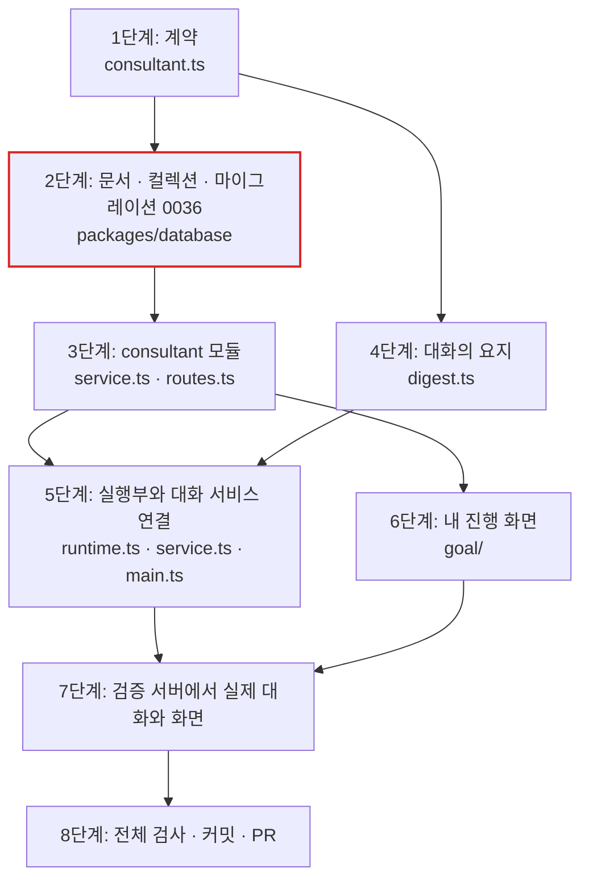

# 컨설턴트의 기억과 내 진행 화면 — 구현 계획

## 바뀌는 파일

| 파일 | 무엇을 |
|---|---|
| `packages/contracts/src/consultant.ts` (새 파일) · `consultant.test.ts` · `index.ts` | 단계, 조건, 요지, 기억, 도구 입력, 응답 |
| `packages/database/src/documents/consultant.ts` (새 파일) · `documents/index.ts` · `collections.ts` | 프로필 문서와 컬렉션 |
| `packages/database/src/mongodb-migrations/0036/migration.ts` (새 파일) · `mongo-migrations.ts` · `mongo-build.mjs` · `schema.test.ts` · `migrations.test.ts` | `consultant_profiles` 만들기, 테스트의 마이그레이션 · 컬렉션 수 |
| `services/backend/src/modules/consultant/` (새 모듈: `index.ts` · `service.ts` · `routes.ts` · `service.integration.test.ts`) | 프로필 읽기 · 단계 · 조건, 라우트 |
| `services/backend/src/modules/agent-chat/digest.ts` (새 파일) · `digest.test.ts` | 대화의 요지 |
| `services/backend/src/modules/agent-chat/service.ts` · `service.integration.test.ts` | 기억 읽기, 실행에 넘기기, `updateMemory` 연결, 최근 요지 조회 |
| `services/backend/src/platform/agent/runtime.ts` · `runtime.test.ts` | `memory` 싣기, `update_memory` 도구, 기억 지침 |
| `services/backend/src/api/main.ts` · `build-app.ts` | 서비스 만들기와 라우트 등록 |
| `services/backend/src/modules/account-lifecycle/mongo-purge.ts` | 삭제 목록 |
| `services/web/src/lib/api/endpoints.ts` | `consultant` 엔드포인트 |
| `services/web/src/app/(app)/goal/` (`page.tsx` · `ProgressSections.tsx` 새 파일 · `ProgressSections.test.tsx` 새 파일 · `goal-actions.ts` · `goal.module.css`) | 「내 진행」 화면 |
| `services/web/src/features/agent-chat/AgentChat.tsx` | 「기억 갱신」 아이콘 |

구현 중 이 표에서 벗어나면 같은 커밋에서 이 파일을 고친다.

## 작업 순서



## 가장 위험한 단계

2단계다. 마이그레이션은 운영 DB에 적용되면 PR을 되돌려도 남는다. 이 마이그레이션은 새 컬렉션을 만들고 색인을 붙일 뿐 기존 문서를 바꾸지 않는다. 번호는 0035다. 0034는 열린 PR #241(`feat/design-chat`)이 쓰고, 그 PR이 번호를 바꾸면 이 번호도 다시 본다. 되돌릴 때는 PR을 되돌리고 `consultant_profiles` 컬렉션을 지운다(사용자 자료가 아닌 컨설턴트의 메모만 들어 있다).

## 검증

```
pnpm typecheck
pnpm test
pnpm test:infra
```
