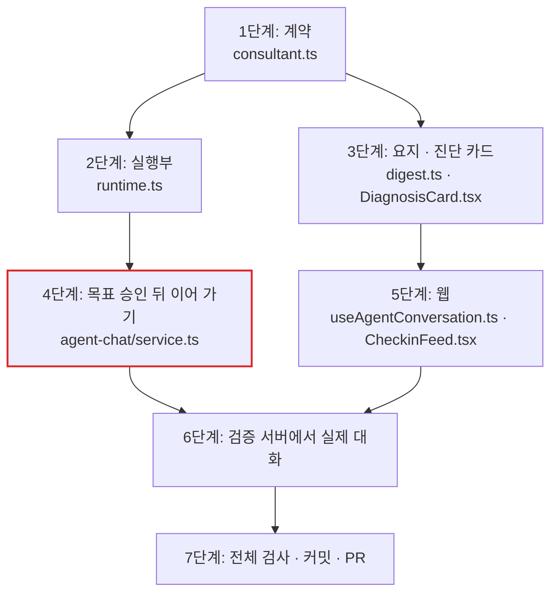

# 운영 완주에서 드러난 컨설턴트 대화의 문제 여섯 건 — 구현 계획

## 바뀌는 파일

| 파일 | 무엇을 |
|---|---|
| `packages/contracts/src/consultant.ts` · 테스트 | `diagnosisCounts` · `diagnosisCountsLine`, 도구 입력 `summary`의 설명 |
| `services/backend/src/platform/agent/runtime.ts` · 테스트 | 지침 세 줄, 글 덩어리 사이 빈 줄, `record_diagnosis`의 요약과 돌려주는 값, 모델에 넘기는 진단 항목의 상태 |
| `services/backend/src/modules/agent-chat/digest.ts` · 테스트 | 요지의 수 |
| `services/backend/src/modules/agent-chat/service.ts` · 통합 테스트 | 목표 카드 승인 뒤 이어 가기 |
| `services/web/src/features/agent-chat/DiagnosisCard.tsx` | 같은 함수로 셈 |
| `services/web/src/features/agent-chat/useAgentConversation.ts` · 테스트 | 다시 읽기의 오류 |
| `services/web/src/app/(app)/home/CheckinFeed.tsx` · 테스트 | 새 `initial` 받기 |

구현 중 이 표에서 벗어나면 같은 커밋에서 이 파일을 고친다.

## 작업 순서



## 가장 위험한 단계

4단계다. 카드 승인이 실행을 시작하면, 승인만 하려던 사용자의 크레딧이 쓰이고 실행 중에는 다른 카드를 처리할 수 없다. 마지막 답변의 카드일 때만 잇고, 보내기의 확인에 걸리면 저장만 하게 한다. 되돌릴 때는 PR을 되돌린다 — 새 저장이 없다.

## 검증

```
pnpm typecheck
pnpm test
pnpm test:infra
```
