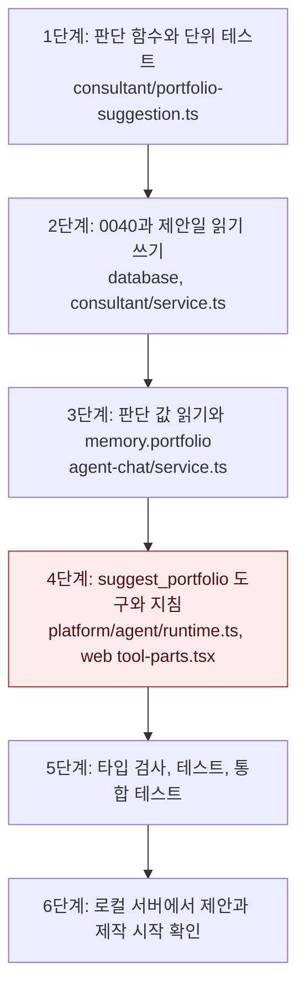

# 포트폴리오 잇기 — 기록이 쌓이면 컨설턴트가 먼저 제안 — 구현 계획

## 바뀌는 파일

| 파일 | 무엇을 |
|---|---|
| `packages/database/src/mongodb-migrations/0040/migration.ts` (새로) | `consultant_profiles` 검증 규칙에 `portfolioSuggestion` 더하기 |
| `packages/database/src/mongo-migrations.ts` · `mongo-build.mjs` · `schema.test.ts` | 0040 등록, dist 복사 목록, 이름 목록 |
| `packages/database/src/documents/consultant.ts` | `ConsultantProfileDoc.portfolioSuggestion` |
| `services/backend/src/modules/consultant/portfolio-suggestion.ts` (새로) · `.test.ts` (새로) | 문턱 상수와 판단 함수, 단위 테스트 |
| `services/backend/src/modules/consultant/service.ts` · `index.ts` · `service.integration.test.ts` | 제안일 읽기 · 쓰기와 진입점 |
| `services/backend/src/platform/agent/runtime.ts` · `runtime.test.ts` | `suggest_portfolio` 도구, `memory.portfolio`, `save_record` 응답, 지침 |
| `services/backend/src/modules/agent-chat/service.ts` · `service.integration.test.ts` | 판단에 넘길 값 읽기, 도구 처리, 기억에 싣기 |
| `services/web/src/features/agent-chat/tool-parts.tsx` · `tool-parts.test.tsx` | 「포트폴리오 제안」을 선택지 부품으로 그리기 |

구현 중 이 표에서 벗어나면 같은 커밋에서 이 파일을 고친다.

## 작업 순서

1. 판단 함수와 단위 테스트 — `portfolio-suggestion.test.ts`가 다섯 상태와 경계(2건 · 3건, 13일 · 14일)를 통과한다.
2. 마이그레이션 0040과 프로필의 제안일 읽기 · 쓰기 — 통합 테스트가 적은 날짜를 다시 읽는다.
3. 대화 서비스의 판단 값 읽기와 `memory.portfolio` — 통합 테스트에서 기록 3건 · 포트폴리오 0건이면 `suggest`가 참이다.
4. 도구 `suggest_portfolio`와 `save_record` 응답, 지침 — `runtime.test.ts`의 도구 목록 검사와 새 테스트가 통과한다.
5. 로컬 서버에서 대화로 확인 — 제안, 수락 뒤 제작 카드, 미룬 뒤 재제안 없음.

## 가장 위험한 단계

4단계다. 지침 문단이 길어 모델이 제안을 엉뚱한 자리에서 내거나, 링크 질문 · 진단 흐름과 겹칠 수 있다. 서버 쪽 안전선은 도구의 재판단(조건이 아니면 돌려보냄)과 "한 답변에 부품 하나"다. 되돌릴 때는 `TOOL_NAMES`에서 도구를 빼고 지침 문단을 지우면 나머지(판단 함수 · 프로필 칸)는 쓰이지 않은 채 남는다. 0040은 허용 칸을 더하기만 해서 되돌릴 필요가 없다.

## 검증

```
pnpm --filter @expresso/backend typecheck
pnpm --filter @expresso/backend test
pnpm test:infra
pnpm --filter @expresso/web typecheck
pnpm --filter @expresso/web test
```

로컬 확인: 따로 둔 DB(`expresso_portfolio_suggest`)에 마이그레이션을 적용하고, 백엔드(`AGENT_CHAT_ENABLED=1`)와 웹을 워크트리에서 띄운 뒤, 기록 2건 · 포트폴리오 0건인 시험 계정으로 대화에서 세 번째 기록을 남긴다. 제안과 두 단추, 수락 뒤 「포트폴리오 제작」 카드를 화면으로 확인한다.


