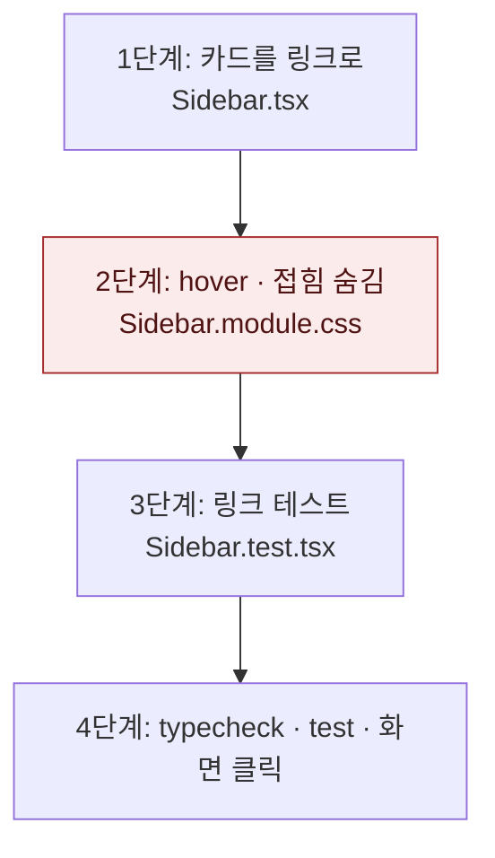

# 사이드바 크레딧 카드 사용량 섹션 연결 — 계획

## 바뀌는 파일

- 고침: `services/web/src/components/shell/Sidebar.tsx`
- 고침: `services/web/src/components/shell/Sidebar.module.css`
- 새로: `services/web/src/components/shell/Sidebar.test.tsx`

## 작업 순서

1. `Sidebar.tsx` — 쿼터 카드 `div`를 `Link href="/account#usage"`로 바꾼다. 확인: 타입 검사 통과.
2. `Sidebar.module.css` — 링크 기본 모양 초기화, hover 테두리, 접힘 시 `visibility` 숨김. 확인: 화면에서 hover와 접힘.
3. `Sidebar.test.tsx` — 카드 링크의 `href`와 게이지가 링크 안에 있는지 검사한다.
4. 검증 — 타입 검사 · 테스트 · 개발 서버 화면에서 클릭 이동 확인.



## 가장 위험한 단계

2단계. `.copy`와 같은 요소라 `transition`을 잘못 쓰면 접힘 애니메이션에서 카드가 즉시 사라진다.
되돌리기: CSS 변경 커밋만 되돌리면 카드는 링크인 채로 기존 모양이 된다.

## 검증 명령

```bash
pnpm --filter @expresso/web typecheck
pnpm --filter @expresso/web test
```
