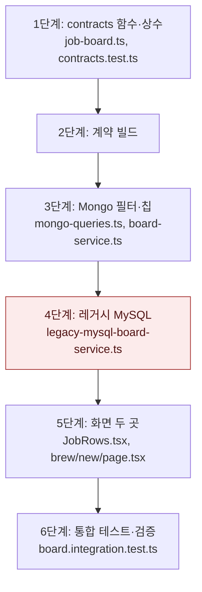

# 마감 임박 경계 통일 — 구현 계획

## 바뀌는 파일

| 파일 | 무엇을 |
|---|---|
| `packages/contracts/src/job-board.ts` | 상수와 판정 함수 세 개 추가, 필터 주석을 "D-7 이내"로 |
| `packages/contracts/src/contracts.test.ts` | 판정 함수 경계 테스트 |
| `services/backend/src/modules/jobs/mongo-queries.ts` | `urgent` 필터를 날짜 범위로 |
| `services/backend/src/modules/jobs/board-service.ts` | 칩 건수와 `daysLeft`를 공용 함수로 |
| `services/backend/src/modules/jobs/legacy-mysql-board-service.ts` | 필터와 칩을 `datediff between`으로 |
| `services/backend/src/modules/jobs/board.integration.test.ts` | 7일째 포함, 8일째 제외 |
| `services/web/src/app/(app)/jobs/JobRows.tsx` | `isUrgentDaysLeft` 사용 |
| `services/web/src/app/(app)/brew/new/page.tsx` | `isUrgentDaysLeft` 사용 |

## 작업 순서



1. contracts 추가 — `pnpm --filter @expresso/contracts test`로 경계(7일째 포함, 8일째 제외, null) 확인.
2. 계약 빌드 — `pnpm --filter @expresso/contracts build`.
3. Mongo 필터와 칩 — 타입 검사 통과.
4. 레거시 MySQL — SQL 문자열만 바뀌므로 타입 검사와 기존 테스트로 확인.
5. 화면 두 곳 — 웹 타입 검사와 `JobRows` 기존 테스트.
6. 통합 테스트 — `pnpm test:infra`.

## 가장 위험한 단계

4단계. MySQL은 로컬 인프라(`infra:up`)에 없을 수 있어 SQL 오타를 통합 테스트로 못 잡는다. 조건은 기존 `days_left` 컬럼과 같은 `datediff` 식이라 구문 위험은 낮다. 문제가 생기면 이 파일만 되돌리면 Mongo 경로는 영향이 없다.

## 검증

```
pnpm --filter @expresso/contracts build
pnpm typecheck
pnpm test
pnpm test:infra
```
