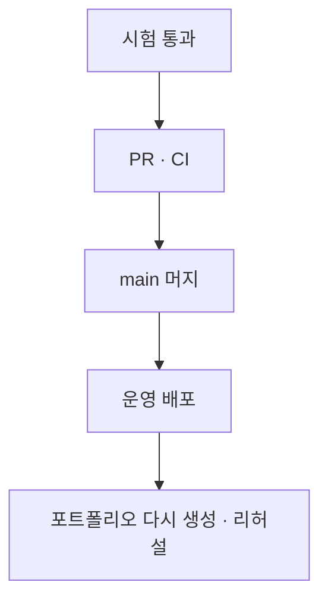

# Plan: 시연 리허설 수정

1. 백엔드: `jobs/mongo-queries.ts`, `jobs/board-service.ts`, `jobs/match-score.ts`, `job-analysis/coverage.ts`, `career/record-period.ts`, `materials/service.ts`, `page/design-first.ts`, `page/element-edit.ts`, `page/routes.ts`, `api/error-handler.ts`, `career-computation/service.ts`.
2. 웹: `jobs/page.tsx`, `jobs/[jobId]/page.tsx`, `brew/[brewId]/analyze/{Reanalyze.tsx,page.tsx,source-marks.ts}`, `edit/[portfolioId]/deploy/*`.
3. 시험: 단위 시험과 `board`·`computation` 통합 시험을 더한다.
4. 검증: `pnpm typecheck` → `pnpm test` → `pnpm test:infra`, 머지 후 운영에서 문가령 계정으로 재확인한다.

