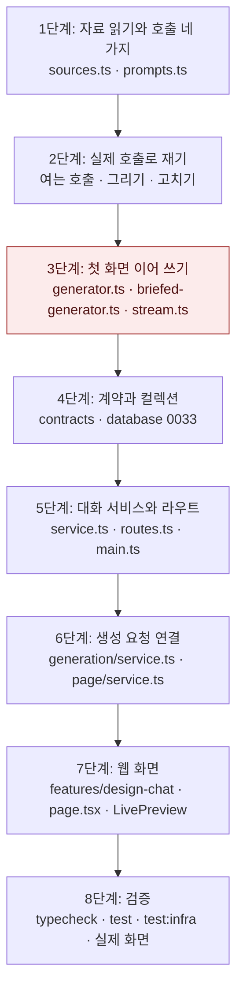

# 디자인 선택 단계의 채팅 전환 — 구현 계획

## 바뀌는 파일

| 파일 | 무엇을 |
|---|---|
| `packages/contracts/src/design-chat.ts` (새로) · `index.ts` · `contracts.test.ts` | 대화 · 견본 · 첫 화면 계약 |
| `packages/contracts/src/generation.ts` | `designSnippetId`와 셋 중 하나 규칙 |
| `packages/database/src/documents/design-chat.ts` (새로) · `documents/index.ts` · `documents/generation.ts` · 포트폴리오 문서 타입 · `collections.ts` | `design_chats` 문서 타입, 생성 · 포트폴리오의 `designSnippetId` |
| `packages/database/src/mongodb-migrations/0033/migration.ts` (새로) · `mongo-migrations.ts` · `mongo-build.mjs` · `migrations.test.ts` · `schema.test.ts` | 컬렉션 · 검증 규칙 · 인덱스 |
| `services/backend/src/modules/account-lifecycle/mongo-purge.ts` | 계정 삭제 목록에 `design_chats` |
| `services/backend/src/modules/page/design-chat/{sources,prompts,service,routes}.ts` (새로) + 테스트 | 자료 읽기 · 호출 네 가지 · 대화 서비스 · 라우트 |
| `services/backend/src/modules/page/service.ts` | `#context`가 `brewPageSources`를 쓰고 `seed`를 싣는다 |
| `services/backend/src/modules/page/generator.ts` · `briefed-generator.ts` · `stream.ts` | `context.seed`, 첫 화면 뒤 이어 쓰기와 붙이기, `seed` 스트림 이벤트 |
| `services/backend/src/modules/page/index.ts` | 대화 서비스 · 첫 화면 조회 내보내기 |
| `services/backend/src/modules/generation/service.ts` | `designSnippetId`로 스타일 정하기, 작업 · 포트폴리오에 싣기 |
| `services/backend/src/api/main.ts` · `api/build-app.ts` | 대화 서비스 조립과 라우트 등록 |
| `services/web/src/features/design-chat/*` (새로) | 대화 화면 · 상태 훅 · 변환 · 스타일 · 테스트 |
| `services/web/src/app/api/brews/[brewId]/design-chat/[[...path]]/route.ts` (새로) | 프록시 |
| `services/web/src/app/(app)/brew/[brewId]/design/page.tsx` · `design-actions.ts` · `LivePreview.tsx` | 화면 분기, `designSnippetId`로 생성, `seed` 이벤트 |
| `services/web/src/lib/api/endpoints.ts` | `designChat.get` |
| `services/web/src/components/assistant-ui/elements/thread.aui.tsx` | 중단을 지원하지 않을 때 멈춤 버튼 숨김 |
| `services/web/src/app/(app)/brew/[brewId]/design/chat/` (삭제) | 시안 라우트와 저장 결과 |
| `docs/architecture/portfolio-free-generation-lab.md` | 디자인 대화와 첫 화면 이어 붙이기 한 절 |

구현 중 이 표에서 벗어나면 같은 커밋에서 이 파일을 고친다.

## 작업 순서



1. 자료 읽기와 호출 네 가지 — `brewPageSources`를 꺼낸 뒤 `page.integration.test.ts`가 그대로 통과하고, 프롬프트 단위 테스트가 통과한다.
2. 실제 호출로 재기 — 임시 스크립트로 윤하린 제작에서 여는 호출 · 그리기 · 고치기를 돌려 시간과 결과를 본다. 여는 호출이 20초를 넘으면 `head`와 견본을 두 호출로 나누는 것을 다시 본다.
3. 첫 화면 이어 쓰기 — 임시 스크립트로 `seed`를 준 자유 생성을 돌려 붙인 지면을 헤드리스 Chrome으로 찍는다. 첫 화면과 뒤 섹션의 색 · 서체가 이어지는지 본다.
4. 계약과 컬렉션 — `pnpm --filter @expresso/contracts test`, `pnpm --filter @expresso/database test`, 복사본 DB에 `pnpm db:migrate`.
5. 대화 서비스와 라우트 — `ScriptedAiClient`로 단위 · 통합 테스트.
6. 생성 요청 연결 — `designSnippetId`로 낸 생성이 Worker에서 끝나고 지면이 고른 첫 화면으로 시작한다.
7. 웹 화면 — 헤드리스 Chrome으로 첫 질문부터 만들기까지.
8. 검증 — 아래 명령.

## 가장 위험한 단계

3단계. 2026-11-17 측정은 모델이 첫 화면까지 다시 쓰는 요청이었고, 뒤만 쓰게 하는 요청은 처음 돌린다. 뒤 섹션이 첫 화면의 클래스와 색을 잇지 않거나, 첫 화면의 `body` 규칙과 부딪힐 수 있다. 여기서 틀어지면 요청 문구를 고쳐 다시 재고, 그래도 안 되면 첫 화면을 다시 쓰게 하되 서버가 맨 앞 요소를 고른 첫 화면으로 바꿔 끼우는 방식으로 돌아간다. 이 단계는 임시 스크립트로 먼저 확인하므로 되돌릴 코드가 적다.

다음으로 위험한 것은 4단계의 마이그레이션이다. 번호가 다른 브랜치와 겹치면 머지에서 드러난다. 컬렉션을 새로 만드는 것뿐이라 되돌릴 때는 `design_chats`를 지우면 된다.

## 검증

```
pnpm typecheck
pnpm test
pnpm test:infra
```

화면: `http://designchat.localhost:3193/brew/ca3e5093-f41f-4aab-8df4-e96799c995a4/design`에서 첫 질문 → 견본 누르기 → 「말로 고치기」 → 넓게 보기 → 「이 스타일 고르기」 → 「이 스타일로 만들기」 → 생성 중 미리보기 → 다듬기 화면. `?view=catalog`에서 기존 화면.
