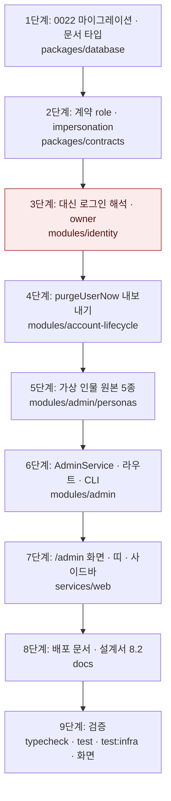

# 관리자 화면과 더미 개발자 계정 5종 — 구현 계획

## 바뀌는 파일

| 파일 | 무엇을 |
|---|---|
| `packages/database/src/mongodb-migrations/0022/migration.ts` (새) | `users` · `identity_sessions` 검증 규칙 확장, `admin_audit_events` 생성 · 인덱스 |
| `packages/database/src/mongo-migrations.ts` | 0022 등록 |
| `packages/database/src/documents/identity.ts` · `operations.ts` · `collections.ts` | `UserDoc.role` · `dummyKey`, 세션 필드, `AdminAuditEventDoc`, 컬렉션 핸들 |
| `packages/database/src/migrations.test.ts` · `schema.test.ts` | 0022 적용 확인 |
| `packages/contracts/src/identity.ts` · `admin.ts` (새) · `index.ts` | `role` · `impersonation`, 관리 응답 스키마 |
| `services/backend/src/modules/identity/*` | `owner` 주체, `actingAsUserId` 해석, 로그아웃 기준, 더미 재설정 메일 차단, legacy 구현 맞춤 |
| `services/backend/src/modules/account-lifecycle/mongo-purge.ts` · `index.ts` | `purgeUserNow` 내보내기 |
| `services/backend/src/modules/admin/` (새) | `personas/*.ts` 5개, `service.ts`, `routes.ts`, `cli.ts`, `index.ts`, 테스트 |
| `services/backend/src/api/build-app.ts` · `package.json` | 라우트 등록, `admin` 스크립트 |
| `services/web/src/lib/api/endpoints.ts` | `admin` 호출 묶음 |
| `services/web/src/app/(app)/admin/` (새) | 화면 · 서버 액션 · 스타일 |
| `services/web/src/components/shell/ImpersonationBar.tsx` (새) · `AppChrome.tsx` · `Sidebar.tsx` | 띠, 관리 항목 |
| `docs/operations/DEPLOYMENT.md` | 관리자 지정 절차 |
| `docs/` 설계서 8.2 | 스크립트로 다시 생성 |

## 작업 순서

1. 0022 마이그레이션과 문서 타입 — `pnpm --filter @expresso/database test` 통과, 복사본 DB에 `db:migrate`가 `applied 0022`.
2. 계약 — `AuthenticatedUserSchema`에 `role` · `impersonation`, `admin.ts`. `pnpm --filter @expresso/contracts build`.
3. identity 대신 로그인 해석 — `verifyAccessToken`이 `actingAsUserId`를 읽고 `owner`를 채움. 로그아웃 기준 변경. identity 통합 테스트 추가.
4. `purgeUserNow` 내보내기 — account-lifecycle 기존 테스트 통과.
5. 가상 인물 원본 5종 — 원본이 템플릿 키 · 선택지 안에 있는지 단위 테스트로 검사.
6. `AdminService` · 라우트 · CLI — `admin.integration.test.ts`(요구사항 전부).
7. 웹 엔드포인트 · `/admin` 화면 · 서버 액션 · 띠 · 사이드바 항목 — `pnpm --filter @expresso/web typecheck`, 화면 확인.
8. 문서 — DEPLOYMENT.md 관리자 지정 절차, 설계서 8.2 재생성.
9. 검증 — 아래 명령과 화면 확인, origin/main 재병합 뒤 PR.



## 가장 위험한 단계

3단계입니다. `verifyAccessToken`은 모든 인증 요청이 지나는 자리입니다. 잘못 고치면 일반 사용자의 요청이 다른 계정으로 해석되거나 전부 401이 됩니다. 대비는 세 가지입니다.

- `actingAsUserId`가 없는 세션은 지금 코드 경로를 그대로 탑니다. 추가 조회는 필드가 있을 때만 합니다.
- 기존 `auth.integration.test.ts` · `identity.integration.test.ts`를 고치지 않고 그대로 통과시킵니다.
- 되돌릴 때는 이 단계 커밋만 되돌립니다. 0022의 새 필드는 선택 필드라 남아 있어도 기존 코드가 읽는 데 지장이 없습니다.

## 검증

```
pnpm typecheck
pnpm test
pnpm test:infra
```

복사본 DB와 서버:

```
# 체험 DB를 expresso_dummy_accounts_trial로 복사 → migration_locks 비움 → pnpm db:migrate
# 웹 3205 · API 4205 · 호스트 dummy.localhost · 워커 QUEUE_PREFIX=expresso-dummy-accounts · AI_PROVIDER=off
pnpm --filter @expresso/backend admin grant dev01@expresso.test
```

화면 경로: `http://dummy.localhost:3205/admin` → 다섯 계정 만들기(기록 수 3 · 10 · 25 · 50 · 100) → 「이 계정으로 보기」 → 홈과 띠 → 공고에서 생성 시작(생성 작업 생성 확인) → 「관리자로 돌아가기」 → 마지막 대신 로그인 갱신. 복사본 DB에 일반 계정을 하나 가입시켜 `/admin`을 열고 「페이지 없음」도 확인합니다. 증거는 스크린샷으로 보고에 붙입니다.
