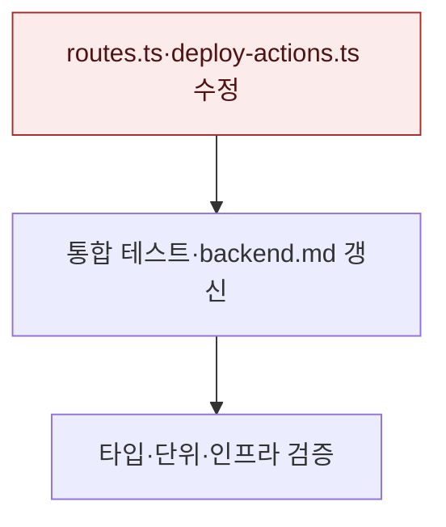

# 포트폴리오 배포 메일 인증 해제 계획
status: accepted

## 변경 파일
- services/backend/src/modules/publishing/routes.ts
- services/backend/src/modules/identity/auth.integration.test.ts
- services/backend/src/modules/publishing/mongodb.integration.test.ts
- services/web/src/app/(app)/edit/[portfolioId]/deploy/deploy-actions.ts
- services/backend/src/modules/identity/mail.ts
- services/web/src/app/(app)/account/page.tsx
- services/web/src/app/verify-email/page.tsx
- docs/architecture/backend.md
- .sitrep/의 이번 작업 기록

## 작업 순서
1. 배포 메일 인증 게이트와 전용 오류 안내를 제거한다.
2. 기존 테스트를 갱신하고 실제 MongoDB 배포 경로에서 미인증 계정의 배포와 인증·소유권 경계를 검증한다.
3. pnpm typecheck, pnpm test, pnpm test:infra를 순차 실행한다.
4. 검증한 변경을 커밋하고 PR·운영 배포로 반영해 운영 API 상태를 확인한다.

## 위험과 복구
메일 소유를 확인하지 않은 계정도 공개 주소를 만들게 된다. 해당 게이트를 복구하는 커밋으로 되돌린다.

## 구현 중 확인한 안내
계정 화면·인증 완료 화면·인증 메일에도 메일 인증이 배포 조건이라는 안내가 있어 함께 정리한다.
