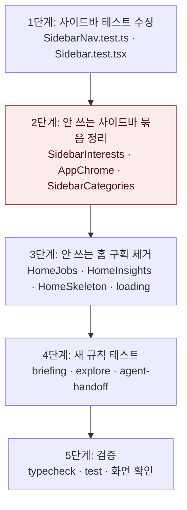

# 네 탭 구조와 홈 화면 — 구현 계획

화면 코드는 시안으로 이미 작업 트리에 있다. 남은 일은 깨진 테스트를 고치고, 쓰지 않게 된 홈 코드를 지우고, 새 규칙에 테스트를 붙이는 것이다.

## 바뀌는 파일

| 파일 | 무엇을 |
|---|---|
| `services/web/src/components/shell/SidebarNav.tsx` · `ShellNav.tsx` · `Sidebar.tsx` · `Sidebar.module.css` | 네 탭, 새 포트폴리오 버튼, 최근 대화 |
| `services/web/src/components/shell/SidebarConversations.tsx` (새로) | 최근 대화 묶음 |
| `services/web/src/components/shell/SidebarNav.test.ts` · `Sidebar.test.tsx` | 새 메뉴에 맞춰 고침 |
| `services/web/src/components/shell/SidebarInterests*` (삭제) · `AppChrome.tsx` · `lib/app-data.ts` | 사이드바에서 쓰지 않는 묶음과 그 데이터 호출 제거 |
| `services/web/src/components/shell/SidebarCategories.tsx` | 라이브러리 왼쪽 목록에서 다시 쓰도록 `hrefBase` · `activeKey` · `heading` 추가 |
| `services/web/src/app/(app)/library/*` (새로) | 라이브러리 화면. 포트폴리오 격자(`home/HomePortfolios.tsx`)를 `PortfolioGrid.tsx` · `portfolio-grid.module.css`로 옮김 |
| `services/web/src/app/(app)/jobs/page.tsx` · `explore.ts` · `ExploreFrame.tsx` · `ExploreActivities.tsx` · `explore.module.css` | 탐색의 종류 목록과 활동 목록 |
| `services/web/src/app/(app)/home/page.tsx` · `HomeStart.tsx` · `HomeWidgets.tsx` · `briefing.ts` · `home-start.module.css` | 홈 시작 화면 |
| `services/web/src/app/(app)/home/HomeJobs*.tsx` · `HomeInsights*.tsx` · `HomeSkeleton.tsx` · `page.module.css` (삭제) · `loading.tsx` · `HomeChrome.tsx` · `home-model.ts` · `home-data.ts` | 걷어낸 구획의 코드 제거. 헤더와 쓰이는 모델 함수만 남김 |
| `services/web/src/styles/tokens.test.ts` | 홈 입력창의 쉬는 곡률(pill)을 곡률 역할 예외에 이유와 함께 추가 |
| `services/web/src/features/agent-chat/AgentChat.tsx` · `useAgentConversation.ts` · `agent-handoff.ts` (새로) | 홈에서 대화로 넘어가기 |
| `services/web/src/features/career-editor/views/record-completeness.ts` (새로) · `QuickFilterBar.tsx` | 판정 함수 분리 |
| `services/web/src/app/(app)/home/briefing.test.ts` · `jobs/explore.test.ts` · `features/agent-chat/agent-handoff.test.ts` (새로) | 규칙 제안, 위비티 행 읽기, 넘기는 말 |

## 작업 순서

1. 사이드바 테스트 두 파일을 새 메뉴에 맞춘다 — `vitest run src/components/shell`이 통과한다.
2. 사이드바에서 쓰지 않는 묶음(`SidebarInterests`)과 `AppChrome`의 포트폴리오 · 관심 공고 호출을 지운다. `SidebarCategories`는 지우지 않고 라이브러리 왼쪽 목록에서 다시 쓴다.
3. 홈에서 쓰지 않는 구획 코드와 스타일을 지운다 — `tsc`가 통과한다.
4. `briefing.ts` · `explore.ts`(행 읽기를 순수 함수로 뺌) · `agent-handoff.ts`에 테스트를 붙인다.
5. 전체 타입 검사와 테스트를 돌리고 검증 서버에서 다섯 화면을 확인한다.



## 가장 위험한 단계

2단계. `SidebarCategories`는 카테고리 추가 · 보관 목록을 품고 있다. 사이드바에서 지우면 카테고리를 추가하는 길이 없어진다. 지우기 전에 라이브러리 목록에 「카테고리 추가」와 「보관됨」이 있어야 한다. 이번에는 컴포넌트를 지우지 않고 라이브러리의 왼쪽 목록에서 다시 쓴다. 되돌릴 때는 `Sidebar.tsx`에 한 줄을 되살린다.

## 검증

```
pnpm --filter @expresso/web typecheck
pnpm --filter @expresso/web test
```

화면: `home.localhost:3181`의 `/home`(입력창 펴짐 · 자료 추가 · 보내기), `/library` · `/library?s=project`, `/jobs` · `/jobs?kind=contest` · `/jobs?kind=intern`, 375px 폭.
