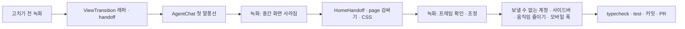

# 홈에서 대화로 넘어가는 전환 — 구현 계획

## 바뀌는 파일

| 파일 | 바꾸는 것 |
|---|---|
| `services/web/src/components/motion/ViewTransition.tsx` | 새 파일. React `ViewTransition` 다시 내보내기, 없으면 자식만 |
| `services/web/src/features/agent-chat/agent-handoff.ts` | 전환 타입 이름, 메모리 보관 · `peekAgentHandoff`, `deliver` |
| `services/web/src/app/(app)/home/HomeHandoff.tsx` | 새 파일. `open` · `pending` 컨텍스트 |
| `services/web/src/app/(app)/home/HomeStart.tsx` · `ProposalFeed.tsx` | `open`으로 시작, `data-leaving`, 입력창 이름 |
| `services/web/src/app/(app)/home/page.tsx` | 홈 · 대화 enter · exit 감싸기 |
| `services/web/src/app/(app)/home/home-start.module.css` | `data-leaving`일 때 옅어짐 |
| `services/web/src/components/assistant-ui/elements/thread.aui.tsx` | `composerTransitionName`, `data-arrival` |
| `services/web/src/features/agent-chat/AgentChat.tsx` · `AgentChat.module.css` | 첫 말풍선, 로딩 · 권한 문구 끄기, 떠오름 |
| `services/web/src/styles/global.css` | 뷰 전환 규칙 · 움직임 줄이기 |
| `services/web/src/features/agent-chat/agent-handoff.test.ts` | 메모리 보관 · 꺼내기 테스트 |

## 작업 순서

## 가장 위험한 단계

첫 말풍선과 서버 메시지의 이음이다. key가 바뀌면 말풍선이 한 번 깜빡이고, 거두는 경로가 하나라도 빠지면 보내지 않은 말이 보낸 것처럼 남는다. 거두는 경로(동의 · 크레딧 · 권한 오류 · 생성 실패 · 전송 실패)를 코드에서 하나씩 짚는다.

## 검증

- 녹화: `scratchpad/transition-probe/probe.mjs`가 Playwright의 Chromium(헤드리스, 보이는 상태)으로 로그인 → 입력 → Enter를 녹화하고, 화면 상태가 바뀐 시각과 `startViewTransition` 호출 · 타입을 남긴다. ffmpeg로 프레임을 뽑아 본다.
- 1280×800과 390×844, `reducedMotion: reduce`.
- 동의가 필요한 계정 경로, 사이드바의 지난 대화.
- `pnpm typecheck`, `pnpm --filter @expresso/web test`.
