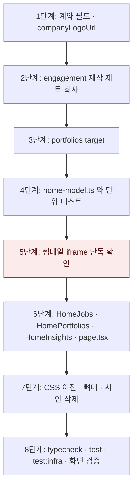

# 홈 화면 목적 기준 재구성 — 구현 계획

## 바뀌는 파일

| 파일 | 무엇을 |
|---|---|
| `packages/contracts/src/engagement.ts` | `activeBrews`에 `title` · `company` 추가 |
| `packages/contracts/src/portfolios.ts` | `PortfolioSummary.target` 추가 |
| `packages/contracts/src/company-logo.ts`(새로) · `index.ts` | `companyLogoUrl` 함수와 내보내기 |
| `services/backend/src/modules/engagement/service.ts` · `legacy-mysql-service.ts` | 제작의 제목 · 회사 읽기. legacy는 null |
| `services/backend/src/modules/engagement/*.integration.test.ts` | 제목 · 회사가 실리는지 확인 |
| `services/backend/src/modules/portfolios/service.ts` · `legacy-mysql-service.ts` | `target` 읽기. legacy는 null |
| `services/backend/src/modules/portfolios/portfolios.integration.test.ts` | 공고 있는 · 없는 포트폴리오의 `target` 확인 |
| `services/backend/src/modules/jobs/legacy-mysql-board-service.ts` | `companyLogoUrl` 사용 |
| `services/web/src/app/(app)/home/page.tsx` | 데이터 읽기와 구획 배치 다시 쓰기 |
| `services/web/src/app/(app)/home/HomeJobs.tsx`(새로) | 공고 카드 |
| `services/web/src/app/(app)/home/HomePortfolios.tsx`(새로) | 제작 · 포트폴리오 카드와 썸네일 |
| `services/web/src/app/(app)/home/HomeInsights.tsx`(새로) | 차트 카드. 시안 `draft/HomeCharts.tsx`를 옮긴다 |
| `services/web/src/app/(app)/home/home-model.ts` · `.test.ts`(새로) | 직군 대응표 · 예시 질문 · 격자 병합 · 이탈 지점 계산과 테스트 |
| `services/web/src/app/(app)/home/home-data.ts`(새로) | 목표 직군 · 공고 · 사이트 대시보드 · 지면 유무를 `cache()`로 읽기 |
| `services/web/src/app/(app)/home/HomeInsights.test.tsx`(새로) | 순환 · 멈춤 · 움직임 줄이기 테스트 |
| `services/web/src/app/(app)/home/HomeChrome.tsx` | 「⌘K」 · 라벨 · 「저장한 검색」 제거, 예시 질문을 인자로 받기 |
| `services/web/src/app/(app)/home/HomeSkeleton.tsx` · `loading.tsx` | 새 배치에 맞춘 뼈대. 「내 커리어」 뼈대 제거 |
| `services/web/src/app/(app)/home/page.module.css` | 시안 `draft.module.css`의 클래스 이전, 쓰지 않는 클래스 삭제, `.jobInitial`의 고정 색 제거 |
| `services/web/src/app/(app)/home/draft/` | 시안 폴더 삭제(커밋한 적 없음) |

## 작업 순서

1. 계약 세 곳을 고치고 `pnpm --filter @expresso/contracts build`가 통과하는지 확인한다.
2. engagement 집계에 제작의 제목 · 회사를 싣는다. 통합 테스트가 통과하는지 확인한다.
3. portfolios 요약에 `target`을 싣는다. 통합 테스트가 통과하는지 확인한다.
4. `home-model.ts`와 단위 테스트를 쓴다. `pnpm --filter @expresso/web test`로 확인한다.
5. 썸네일 iframe을 먼저 단독으로 붙여서 지면이 실제로 그려지는지 화면으로 확인한다.
6. `HomeJobs` · `HomePortfolios` · `HomeInsights`를 만들고 `page.tsx`를 다시 쓴다. 시안과 같은 화면이 나오는지 확인한다.
7. CSS를 옮기고 뼈대를 맞춘다. 시안 폴더를 지우고 쓰지 않는 클래스가 없는지 확인한다.
8. 검증을 돌린다(아래).



구현하며 바뀐 것:
- 마감일을 모르는 공고는 「상시」 대신 아무것도 적지 않는다. 06 공고 목록의 `deadlineLabel`을 가져다 쓴다.
- 썸네일 틀을 세우기 전에 `page.latest`로 지면이 있는지 확인한다(`portfoliosWithPage`). 없으면 빗금.
- 같은 날 배포한 사이트는 차트 바닥 눈금을 나란히 세우고 판 번호를 한 줄로 묶는다.

## 가장 위험한 단계

5단계, 썸네일 iframe이 가장 위험하다. (2026-11-03 확인: 미리보기 문서가 세션 쿠키로 열리고, 등장 애니메이션이 CSS 스크롤 타임라인이라 내용이 숨지 않았다. 되돌리지 않았다.) 미리보기 문서는 `script-src 'none'` 아래에서 열린다. 지면 키트의 등장 애니메이션이 스크립트로 내용을 드러내는 방식이면 썸네일이 빈 채로 보인다.

- 확인 방법: dev01의 지면 3개를 iframe으로 붙여 1440px 화면에서 본다.
- 되돌리는 방법: 비어 보이면 시안이 썼던 `PagePreview`(`srcDoc` · `reveal={false}`)로 바꾼다. 이때 홈 응답이 커지는 것을 막기 위해 썸네일 수를 격자 5칸으로 제한한다. 바꿨다면 같은 커밋에서 이 plan과 spec의 「버린 대안」을 고친다.

## 검증

```
pnpm typecheck
pnpm test
pnpm test:infra
```

화면 확인 순서:

1. 웹 3135 · API 4135를 띄운다(`.claude/launch.json`의 `home-purpose-*`). DB는 `expresso_home_audit`이다.
2. dev01 계정으로 확인한다. 이 계정은 배포 사이트 2개가 있고 방문 집계가 0건이다. 공개 사이트를 열어 방문을 만든 뒤 `analytics.aggregate`로 집계한다.
   - 공고 카드에 프론트엔드 공고가 보인다.
   - 격자에 제작 카드와 썸네일이 보인다.
   - 차트 카드가 넘어가고, 포인터를 올리면 멈춘다.
3. 빈 계정으로 첫 기록 카드와 오른쪽 열 없음을 확인한다.
4. 375px에서 가로 넘침 0건, 콘솔 오류 0건을 확인한다. 확인에는 헤드리스 점검 스크립트를 쓴다.
