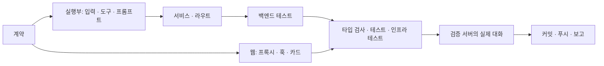

# 대화에서 구직 목표 읽기 · 고치기 — 구현 계획

## 바뀌는 파일

| 파일 | 바꾸는 것 |
|---|---|
| `packages/contracts/src/agent-chat.ts` | 목표 초안의 입력 · 초안 · 결정 계약, 도구 결과의 `goalDraft` |
| `services/backend/src/platform/agent/runtime.ts` | `jobGoal` 전달, `propose_job_goal_update` 도구, 모델에 넘기는 초안 상태, 프롬프트 문단 |
| `services/backend/src/platform/agent/runtime.test.ts` | 허용 도구 목록, `conversationForModel`의 `goalDraft` |
| `services/backend/src/modules/agent-chat/goal-draft.ts` | 초안 만들기와 병합(순수 함수) |
| `services/backend/src/modules/agent-chat/service.ts` | 목표 읽기, `goalDraft` 처리기, `decideGoalDraft` |
| `services/backend/src/modules/agent-chat/routes.ts` | `goal-drafts/:draftId` |
| `services/backend/src/modules/agent-chat/service.integration.test.ts` | 승인 · 거절 · 멱등 · 실행 중 · 앞선 초안 닫기 · 병합 |
| `services/web/src/app/api/agent/[...path]/route.ts` | `goal-drafts` 허용 |
| `services/web/src/features/agent-chat/useAgentConversation.ts` | `decideGoalDraft` |
| `services/web/src/features/agent-chat/JobGoalDraftCard.tsx` · `RecordDraftCard.module.css` | 변경 카드, 바뀌는 칸 줄 스타일 |
| `services/web/src/features/agent-chat/AgentChat.tsx` | 도구 결과 분기, 도구 아이콘 |

## 작업 순서

## 가장 위험한 단계

실제 대화다. 프롬프트의 「분명히 말하면 바로 카드, 달라 보이기만 하면 질문」 경계는 테스트로 볼 수 없다. 다섯 장면을 실제로 돌린다 — 분명한 변경, 암시, 목표 없음, "네"로 확인, 그대로 두기. 경계가 어긋나면 프롬프트 문단을 고친다.

## 검증

- `pnpm typecheck` → `pnpm test` → `pnpm test:infra`.
- 검증 서버(`home.localhost:3181`)에서 dev01로 대화한다. 확인 뒤 dev01의 목표를 원래 글로 되돌린다.
- 화면에서 보는 것: 카드의 지금 글 → 새 글, 저장 뒤 `/goal`의 글, 그대로 두기, 새 카드가 서면 앞선 카드가 닫히는 것, 모바일 폭.
