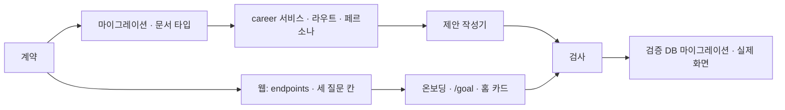

# 최종 구직 목표 기억 — 구현 계획

## 바뀌는 파일

| 파일 | 바꾸는 것 |
|---|---|
| `packages/contracts/src/career.ts` | `JobGoal` 계약 추가, `primaryGoal` 제거 |
| `packages/database/src/documents/career.ts` · `mongodb-migrations/0033/` · `mongo-migrations.ts` · `mongo-build.mjs` | `users.jobGoal`, 검증 규칙과 옛 값 정리 |
| `services/backend/src/modules/career/{service,routes,index}.ts` | 목표 읽기 · 저장, 프로필 읽기의 칸 고르기 |
| `services/backend/src/modules/admin/personas/*` · `admin/service.ts` | `primaryGoal` 제거 |
| `services/backend/src/modules/proposals/{service,writer}.ts` | 목표를 읽어 프롬프트에 넣기 |
| `services/web/src/lib/api/endpoints.ts` | 목표 읽기 · 저장 |
| `services/web/src/features/job-goal/` | 세 질문 칸과 스타일 |
| `services/web/src/app/(auth)/onboarding/goal/GoalForm.tsx` · `page.tsx` · `onboarding-actions.ts` | 세 질문, 함께 저장 |
| `services/web/src/app/(app)/goal/` | 앱 안의 구직 목표 화면 |
| `services/web/src/app/(app)/home/{HomeWidgets,ProposalFeed}.tsx` | 구직 목표 카드, 머리줄의 「목표」, 켜기 대화상자 문구 |
| `docs/design-doc/07-API-설계.md` · `08-데이터-설계.md` | 프로필 계약과 저장 칸 |

## 작업 순서

## 가장 위험한 단계

`primaryGoal` 제거다. 검증 규칙, 저장된 문서, 프로필 읽기, 페르소나, 테스트가 함께 바뀌어야 한다. 마이그레이션을 검증 DB에 돌린 뒤 옛 값이 있던 계정으로 홈과 온보딩을 열어 확인한다.

## 검증

- `pnpm typecheck` → `pnpm test` → `pnpm test:infra`.
- 검증 DB에 `0033`을 돌린다.
- 화면: 온보딩 목표 화면(저장 · 다시 보기), 목표 없는 계정의 홈 카드, `/goal` 저장 뒤 홈, 제안을 새로 만든 메시지.
- 새로 생기는 화면(온보딩 세 질문, `/goal`, 홈 카드)은 그려지는 대로 캡처해 보인다.
