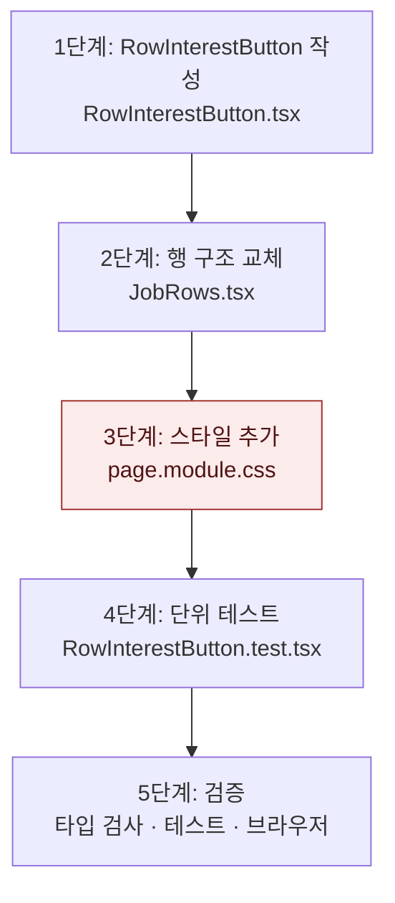

# 공고 목록 북마크로 관심 공고 담기 — 구현 계획

## 바뀌는 파일

| 파일 | 무엇을 |
|---|---|
| `services/web/src/app/(app)/jobs/RowInterestButton.tsx` | 새로 만든다. 낙관적 갱신 북마크 버튼 |
| `services/web/src/app/(app)/jobs/RowInterestButton.test.tsx` | 새로 만든다. 담기 · 해제 · 실패 |
| `services/web/src/app/(app)/jobs/JobRows.tsx` | 행을 `div`로, 링크를 제목으로, 아이콘을 버튼으로 교체 |
| `services/web/src/app/(app)/jobs/page.module.css` | `.rowLink` · `.rowInterestForm` · `.rowInterest` 추가, `.row`에 `position: relative` |

## 작업 순서



1. 버튼 컴포넌트 — 타입 검사 통과
2. 행 구조 교체 — `job.interest !== null` 로 담김 판정, 타입 검사 통과
3. 스타일 — 브라우저에서 행 배치가 수정 전과 같다
4. 테스트 — 3건 통과
5. 검증 — 아래 명령과 화면 조작

## 가장 위험한 단계

3단계. 행 전체를 덮는 `::after`가 북마크 클릭을 가로채거나, 행의 간격이 바뀔 수 있다. 문제가 생기면 `z-index`와 `margin`을 조정하고, 안 되면 `JobRows.tsx`와 `page.module.css`의 변경을 되돌리면 이전 동작(아이콘만 표시)으로 돌아간다.

## 검증

```
pnpm --filter @expresso/web typecheck
pnpm --filter @expresso/web test
```

화면(복사 DB `expresso_bookmark_check`, API 4116, 웹 3116, `AI_PROVIDER=off`)에서 확인한 결과:

- 첫 행 북마크 클릭 → 주소 `/jobs` 유지, 아이콘 채움, 헤더 "관심 공고 1", DB `interests`에 1건
- 새로고침 후에도 채움 유지
- 두 번째 행 담기 → 헤더 2, 첫 행 빼기 → 헤더 1
- 행 본문 클릭 → `/jobs/<id>` 이동
