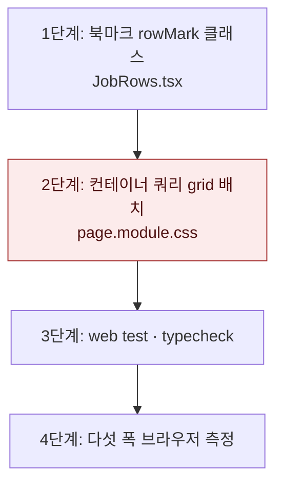

# 좁은 공고 목록 두 줄 행 배치 — 구현 계획

브랜치 `fix/job-row-narrow-layout`은 `fix/job-row-stack-overflow`(PR #208) 위에 쌓는다. `StackChips`와 `.rowStack` 규칙을 이어 쓰기 때문이다. PR은 #208 브랜치를 기준으로 열고, #208이 머지되면 `main`으로 바꾼다.

## 바뀌는 파일

| 파일 | 무엇을 |
|---|---|
| `services/web/src/app/(app)/jobs/JobRows.tsx` | 북마크 `Icon`에 `className={styles.rowMark}`, 인라인 `flexShrink` 제거 |
| `services/web/src/app/(app)/jobs/page.module.css` | `.rows` 컨테이너, `.rowMark`, `@container (max-width: 767px)` grid 배치, 767px 미디어 쿼리의 `.rowTitle` 규칙 제거 |

## 작업 순서

1. `JobRows.tsx`에 북마크 클래스를 단다 — 타입 검사 통과.
2. `page.module.css`에 컨테이너와 grid 배치를 넣는다 — 375px에서 제목 칸이 목록 폭에 맞게 늘어난다.
3. 테스트와 타입 검사를 돌린다.
4. 다섯 폭(375 · 768 · 1024 · 1280 · 1440px)에서 스크롤 폭, 제목 칸, 줄 수를 잰다.



## 가장 위험한 단계

2단계. `.rows`에 크기 컨테이너를 두면 그 안의 레이아웃이 바뀌어, 넓은 화면의 한 줄 배치에도 영향을 줄 수 있다. 1440px에서 행 너비 804와 점수 열 x 880이 앞선 수정과 같은지 확인한다. 깨지면 `page.module.css` 변경만 되돌리면 된다.

## 검증

```
pnpm --filter @expresso/web test
pnpm --filter @expresso/web typecheck
```

화면: `http://stack.localhost:3151/jobs?country=한국`. 폭마다 `.rows`의 `scrollWidth`와 `clientWidth`, 첫 행 `.rowTitle` 폭, 행의 `display`를 잰다. 375px과 1024px은 스크린샷을 남긴다.

구현 중 확인: 처음 쓴 543px 경계는 `tokens.test.ts`(중단점 표 밖의 폭 금지)에 걸려 767px로 바꿨다. grid에 행의 `gap: 14px`가 줄 간격으로도 들어가 칩 없는 행에 빈 셋째 줄이 생겨, 좁은 배치에서 `row-gap: 0`을 둔다.

결과(2026-11-10, 목록 폭 · 배치 · 제목 칸 · 가로 스크롤):

| 화면 | 목록 | 배치 | 제목 칸 | `scrollWidth` |
|---|---|---|---|---|
| 375 | 345 | 두 줄 | 205 (전 19) | 345 |
| 768 | 714 | 두 줄 | 574 | 714 |
| 1024 | 388 | 두 줄 | 248 (전 236, 가로 스크롤 523) | 388 |
| 1280 | 644 | 두 줄 | 504 | 644 |
| 1440 | 804 | 한 줄 | 236 | 804 |

칩 행은 모든 폭에서 「PyTorch · Hugging Face · +19」이고 잘린 칩이 없다. 행 높이는 칩 없는 행 92px, 칩 행 123px(한 줄 배치 67px).
