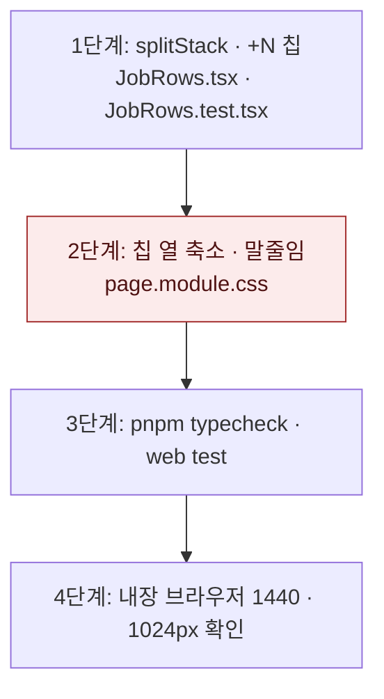

# 공고 목록 기술 칩 넘침 수정 — 구현 계획

## 바뀌는 파일

| 파일 | 무엇을 |
|---|---|
| `services/web/src/app/(app)/jobs/JobRows.tsx` | `STACK_LIMIT` · `splitStack` 추가, 칩 3개와 「+N」 칩 렌더링 |
| `services/web/src/app/(app)/jobs/page.module.css` | `.rowStack` 축소 허용, `.stackChip` 말줄임, `.stackChipMore` 추가 |
| `services/web/src/app/(app)/jobs/JobRows.test.tsx` (새 파일) | `splitStack` 경계와 「+N」 칩 렌더링 테스트 |

## 작업 순서

1. `JobRows.tsx`에 `splitStack`과 「+N」 칩을 넣는다 — 테스트 파일이 칩 4개 입력에서 이름 칩 3개와 「+1」을 찾는다.
2. `page.module.css`의 칩 열과 칩 규칙을 고친다 — 내장 브라우저 1440px에서 `.rows`의 `scrollWidth`가 `clientWidth`와 같다.
3. 테스트와 타입 검사를 돌린다.
4. 1440px과 1024px에서 칩 21개 행의 열 정렬과 「+18」을 화면으로 확인한다.



## 가장 위험한 단계

2단계. `.rowStack`이 줄어들 수 있게 되면 폭이 모자란 화면에서 칩이 남는 폭을 다른 칸과 나눠 쓰게 된다. 데스크톱에서는 근거 칸이 먼저 비므로 칩이 줄지 않아야 한다. 1024px에서 칩 3개가 말줄임 없이 보이는지 확인한다. 깨지면 `page.module.css` 변경만 되돌리면 된다. 칩 개수 제한(1단계)만으로도 칩 21개 행의 넘침은 사라진다.

## 검증

```
pnpm --filter @expresso/web test -- JobRows
pnpm typecheck
```

화면: `http://stack.localhost:3151/jobs?country=한국`(이 워크트리의 웹, API는 4141). 1440×900과 1024×800에서 `.rows`의 `scrollWidth`와 `clientWidth`를 비교하고, 칩 21개 행의 점수·마감·북마크 x 좌표가 다른 행과 같은지 잰다.
