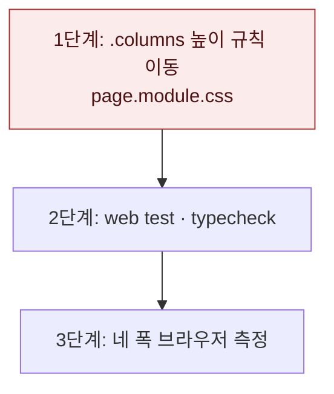

# 좁은 화면 공고 탐색 페이지 스크롤 — 구현 계획

브랜치 `fix/jobs-narrow-page-scroll`은 `fix/job-row-narrow-layout`(PR #211) 위에 쌓는다. 휴대폰 검증에서 두 줄 행 배치를 함께 봐야 하기 때문이다. PR(#220)을 연 시점에 #208 · #211이 이미 `main`에 머지되어 기준 브랜치를 `main`으로 바꿨다.

## 바뀌는 파일

| 파일 | 무엇을 |
|---|---|
| `services/web/src/app/(app)/jobs/page.module.css` | `.columns`의 `flex: 1; min-height: 0`을 `@media (min-width: 1024px)` 안으로 옮기고 주석 갱신 |

## 작업 순서

1. `.columns` 규칙을 옮긴다 — 375px에서 `.content`가 스크롤된다.
2. 테스트와 타입 검사를 돌린다.
3. 네 폭(375 · 768 · 1024 · 1440px)에서 스크롤 상자와 높이를 잰다. 375px은 스크롤 전후 스크린샷을 남긴다.



## 가장 위험한 단계

1단계. 1024px 이상에서 `.columns`가 남은 높이를 채우지 못하면 넓은 화면의 칸별 스크롤이 깨진다. 1440px에서 `.content`가 스크롤되지 않고 `.rows`만 스크롤되는지 확인한다. 깨지면 이 규칙 이동만 되돌리면 된다.

## 검증

```
pnpm --filter @expresso/web test
pnpm --filter @expresso/web typecheck
```

화면: `http://stack.localhost:3151/jobs`. 폭마다 `.content` · `.rows` · `.rail`의 `scrollHeight`와 `clientHeight`, `.results` 높이를 잰다.

변경 전(375×812): `.content` 704/704(스크롤 없음), `.columns` 562, `.results` 274, `.rows` 1871/155, `.rail` 345/272.

결과(2026-11-10, `scrollHeight`/`clientHeight`):

| 화면 | `.content` | `.results` 높이 | `.rows` | `.rail` |
|---|---|---|---|---|
| 375×812 | 2493/704 (페이지 스크롤) | 1990 (전 274) | 1871/1871 | 345/345 |
| 768×1024 | 1934/968 (페이지 스크롤) | 1539 | 1440/1440 | 230/230 |
| 1024×768 | 712/712 | 563 | 1440/464 (칸 스크롤) | 563/563 |
| 1440×900 | 844/844 | 695 | 1180/596 (칸 스크롤) | 695/695 |

375px 첫 화면에 공고 여섯 건이 보인다(전 한두 건). `.content`의 아래 끝(756)이 하단 탭 막대 위 끝과 같아 마지막 카드가 막대에 가리지 않는다.
