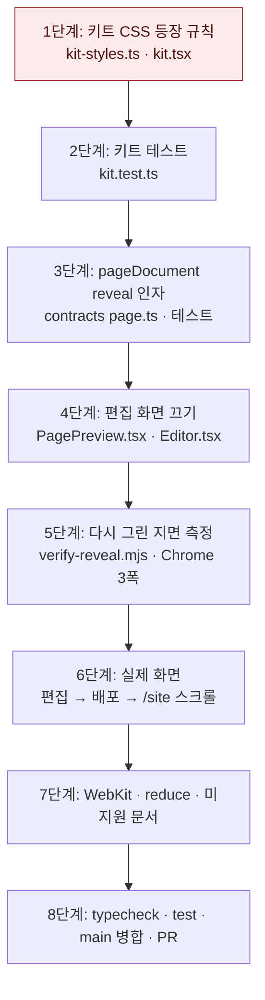

# 포트폴리오 스크롤 등장 애니메이션 공통 규칙 — 구현 계획

## 바뀌는 파일

| 파일 | 무엇을 |
|---|---|
| `packages/portfolio-renderer/src/kit-styles.ts` | 모션 절을 등장 규칙으로 교체. 머리 주석에 쓰는 법 |
| `packages/portfolio-renderer/src/kit.tsx` | `xp-evidence-list`에 `data-reveal="stagger"` |
| `packages/portfolio-renderer/src/kit.test.ts` | 등장 선언 위치 · 끄는 조건 · 옛 규칙 제거 단언 |
| `packages/contracts/src/page.ts` | `pageDocument`의 `reveal` 인자 |
| `packages/contracts/src/contracts.test.ts` | `reveal: false` 문서의 루트 속성 단언. 인자 없는 문서는 그대로 |
| `services/web/src/components/portfolio/PagePreview.tsx` | `reveal` 속성을 `pageDocument`로 전달 |
| `services/web/src/app/(app)/edit/[portfolioId]/Editor.tsx` | 가운데 지면 `PagePreview`에 `reveal={false}` |
| `scripts/library/renderer/verify-reveal.mjs` (새 파일) | 헤드리스 Chrome · WebKit 스크롤 측정 스크립트 |

## 작업 순서

1. 키트 CSS: `kit-styles.ts` 모션 절 교체, `kit.tsx` 속성 추가 — `pnpm --filter @expresso/portfolio-renderer test` 통과.
2. 키트 테스트: `kitCss()` 결과에서 `animation-timeline` 선언이 `no-preference` · `@supports` 블록 안에만 있는지, `data-stage` · `data-reveal="none"` · `data-motion="none"` 조건이 있는지, 옛 `.xp-inner>.xp-block` 규칙이 없는지 단언 — 같은 명령 통과.
3. 문서 래퍼: `pageDocument({ reveal })`와 테스트 — `pnpm --filter @expresso/contracts test` 통과.
4. 웹: `PagePreview` 속성, `Editor.tsx` 한 줄 — `pnpm --filter @expresso/web typecheck` 통과.
5. 측정 스크립트: 저장된 지면의 Spec · 내용(`generationManifest.structured`)과 디자인을 새 키트로 다시 그려 문서를 만들고 세 폭에서 스크롤하며 단위별 `opacity` · `animationName`을 기록 — Chrome 결과가 spec 완료 기준을 만족.
6. 실제 화면: 웹 3203 · API 4203 · `reveal.localhost`로 띄워 dev01 지면 하나를 편집해 다시 그린 뒤 배포. `/site/<slug>`를 내장 브라우저로 열어 스크롤 화면을 확인. 편집 화면 가운데 지면에서 화면 밖 블록이 보이는지 확인.
7. WebKit · 끄는 조건: 측정 스크립트를 WebKit, `reducedMotion: "reduce"`, `@supports`를 막은 문서로 각각 돌림 — 모든 단위가 스크롤 없이 `opacity 1`.
8. 마무리: `pnpm typecheck` · `pnpm test`, origin/main 병합, 커밋 · 푸시 · PR.



## 가장 위험한 단계

1단계다. 단위 선택자가 넓으면 키트의 격자 자식(넓은 여백 배치의 2열 자식, 쇼케이스 그림)에 `transform`이 걸려 고정 · 넘침 측정이 흔들릴 수 있다. 등장은 `transform:none`으로 끝나지만 진행 중에는 쌓임 맥락이 생긴다. 5단계 측정에서 넘침이나 고정 머리 이상이 보이면 단위를 `.xp-head`와 본문 묶음으로 좁힌다. 되돌릴 때는 `kit-styles.ts` 모션 절만 이전 커밋으로 돌리면 된다. 다른 파일의 변경은 등장 규칙이 없어도 동작에 영향이 없다.

`Editor.tsx`는 다듬기 세션이 함께 고치는 파일이다. 한 줄만 바꾸고 PR 전에 origin/main을 병합해 충돌을 확인한다.

## 검증

```
pnpm typecheck
pnpm test
node scripts/library/renderer/verify-reveal.mjs --page <generated_pages _id> --browser chromium
node scripts/library/renderer/verify-reveal.mjs --page <id> --browser webkit
node scripts/library/renderer/verify-reveal.mjs --page <id> --browser chromium --reduced-motion
node scripts/library/renderer/verify-reveal.mjs --page <id> --browser chromium --no-supports
```

WebKit 검증에는 Playwright WebKit 빌드가 필요하다. 지금 이 기기에는 Chromium만 있다(`~/Library/Caches/ms-playwright`). `pnpm --filter @expresso/backend exec playwright install webkit`으로 받는다(사용자 허용 2026-10-28).

화면 확인: `http://reveal.localhost:3203/edit/<portfolioId>` → 배포 → `http://reveal.localhost:3203/site/<slug>`에서 맨 위부터 끝까지 스크롤한다.
