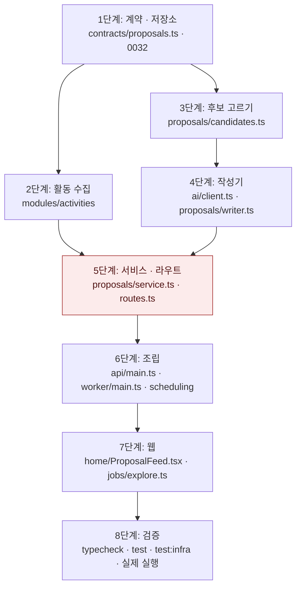

# 에이전트 능동 제안 — 구현 계획

## 바뀌는 파일

| 파일 | 무엇을 |
|---|---|
| `packages/contracts/src/proposals.ts` (새로) · `index.ts` | 제안 · 실행 상태 · 활동 스키마 |
| `packages/database/src/documents/proposals.ts` (새로) · `documents/index.ts` · `collections.ts` · `documents/operations.ts` | `proposal_feeds` · `activities` 문서와 예약 잡 키 |
| `packages/database/src/mongodb-migrations/0032/migration.ts` (새로) · `mongo-migrations.ts` | 두 컬렉션 생성, 예약 잡 둘 등록 |
| `services/backend/src/platform/ai/client.ts` · `modules/consent/public.ts` | 계약 `proposal_briefing`(haiku · `career_records`) |
| `services/backend/src/modules/entitlements/service.ts` · `index.ts` | `credits(userId)` |
| `services/backend/src/modules/activities/*` (새로) | 위비티 읽기, 수집, 목록, 라우트 |
| `services/backend/src/modules/proposals/*` (새로) | 후보 고르기, 작성기, 요청문, 서비스, 라우트 |
| `services/backend/src/modules/scheduling/public.ts` · `service.ts` | 예약 잡 둘과 수집 뒤 새 소식 실행 |
| `services/backend/src/api/main.ts` · `api/build-app.ts` · `worker/main.ts` | 조립, 라우트 등록, `proposals.generate` 처리 |
| `services/backend/src/modules/account-lifecycle/mongo-purge.ts` | `proposal_feeds` 삭제 연동 |
| `services/backend/src/platform/ai/fixes.test.ts` · `ai.test.ts` | 새 계약의 스키마 · 단계 검사 |
| `services/web/src/lib/api/endpoints.ts` · `lib/usage-copy.ts` | `proposals` · `activities` 호출, 사용량 라벨 |
| `services/web/src/app/(app)/home/ProposalFeed.tsx` · `proposal-actions.ts` (새로) · `HomeWidgets.tsx` · `home-start.module.css` | 켜기 창, 제안 카드, 진행 표시, 규칙 제안은 대신 보일 때만 |
| `services/web/src/app/(app)/jobs/explore.ts` · `ExploreActivities.tsx` · `explore.test.ts` | 위비티를 직접 읽지 않고 `GET /activities`를 읽음 |

## 작업 순서

1. 계약과 저장소: 스키마, 문서 타입, 마이그레이션 0032 — `pnpm db:migrate`가 0032를 적용한다.
2. 활동 수집: `wevity.ts`(웹의 읽기 함수를 옮김) · `service.ts` · 라우트 · 예약 잡 — 단위 테스트와 통합 테스트.
3. 후보 고르기: `candidates.ts` — 단위 테스트(용어 뽑기, 점수, 새 항목 창, 제외 목록).
4. 작성기: 계약 등록, `writer.ts`, `prompts.ts` — `ScriptedAiClient` 단위 테스트(후보 밖 항목 걸러짐).
5. 서비스와 라우트: 켜기 · 끄기 · 다시 받기 · 관심 없음 · 실행 · 자동 실행 대상 고르기 — 통합 테스트.
6. 조립: API · 워커 · 예약 · 계정 삭제.
7. 웹: 엔드포인트, 홈 제안 공간, 탐색이 저장분을 읽음.
8. 검증 서버에서 실제 실행: `AI_PROVIDER=claude-code`, 워커 실행, 켜기부터 다시 받기까지.



## 가장 위험한 단계

5단계. 실행 상태(`running`)가 풀리지 않으면 「다시 받기」가 영영 막히고, 자동 실행 제한이 틀리면 수집 한 번에 사용자마다 여러 번 실행돼 크레딧이 샌다. 실행을 시작할 때 조건부 갱신으로 한 번만 잡고, 10분이 지난 `running`은 실패로 본다. 통합 테스트로 두 경우를 고정한다. 되돌릴 때는 예약 잡 정의의 `nextRunAt`을 먼 날짜로 밀면 자동 실행이 멈춘다.

## 검증

```
pnpm typecheck
pnpm test
pnpm test:infra
```

화면: 검증 서버 `home.localhost:3181/home`에서 제안 켜기 → 진행 표시 → 제안 카드 → 단추로 입력창 채우기 → 보내기 → 관심 없음 → 다시 받기. `/jobs?kind=contest`가 저장분을 보인다. DB에서 `ai_usage_events`의 `proposal_briefing` 행과 `proposal_feeds` 문서를 확인한다.
