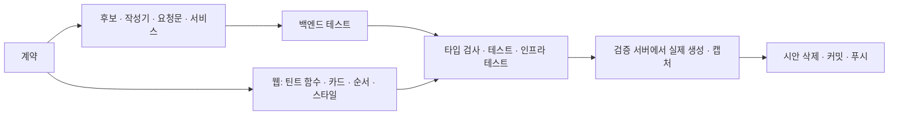

# 홈 제안 카드 재구성 — 구현 계획

## 바뀌는 파일

| 파일 | 바꾸는 것 |
|---|---|
| `packages/contracts/src/proposals.ts` | `message` 도입, `title` · `reason` 제거, `ProposalRef`에 `sub` · `company` · `categoryKey` · `activityKind` |
| `services/backend/src/modules/proposals/candidates.ts` | 공고의 회사 아바타, 기록의 서랍 키를 후보에 실음 |
| `services/backend/src/modules/proposals/writer.ts` | 초안 스키마 · 프롬프트 · 검사 · 수락 |
| `services/backend/src/modules/proposals/prompts.ts` | 버튼 문구 |
| `services/backend/src/modules/proposals/service.ts` | `#proposal` 조립, 옛 모양 거르기 |
| `services/backend/src/modules/proposals/*.test.ts` | 새 모양에 맞춤, 옛 모양 거르기 테스트 추가 |
| `services/web/src/components/ui/company-avatar-tint.ts` | 색상(hue)으로 틴트를 얻는 함수 내보내기 |
| `services/web/src/app/(app)/home/HomeStart.tsx` | 위젯 → 제안 순서 |
| `services/web/src/app/(app)/home/ProposalFeed.tsx` | 카드 · 켜기 전 · 만드는 중 · 규칙 제안을 위젯 틀로 |
| `services/web/src/app/(app)/home/home-start.module.css` | 제안 카드 스타일 교체, 쓰지 않는 규칙 삭제 |
| `services/web/src/app/(app)/home/page.tsx` · `HomeWidgets.tsx` | 주석과 스켈레톤 |
| `services/web/src/app/(app)/home/draft/` | 시안 라우트 삭제(커밋하지 않은 파일) |

## 작업 순서

## 가장 위험한 단계

실제 생성 확인이다. 시안의 메시지는 손으로 쓴 글이라 가장 낮은 단계의 모델이 쓴 메시지를 본 적이 없다. 길이를 넘기거나 기록 제목을 나열하면 프롬프트를 고쳐 다시 만든다. 검증 계정의 옛 제안 문서는 지우고 다시 켠다 — 남아 있으면 그 대상이 후보에서 빠진다.

## 검증

- `pnpm typecheck` → `pnpm test` → `pnpm test:infra`.
- 워커를 `AI_PROVIDER=claude-code` · `SCHEDULED_JOBS_ENABLED=false`로 띄우고 검증 서버에서 제안을 켠다.
- 화면에서 보는 것: 카드의 인용 줄, 긴 공고 제목, 로고 없는 회사, 「관심 없음」 · 「다시 받기」, 대화로 넘어가는 버튼, 모바일.
- 사용자가 아직 보지 못한 상태(켜기 전 · 켜기 대화상자 · 만드는 중 · 사유 문구)는 캡처해 따로 보인다.
