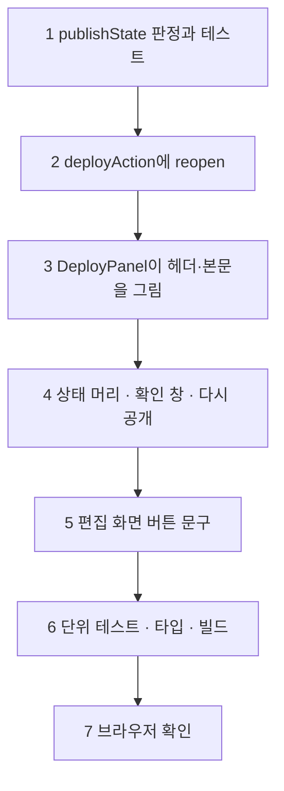

# Plan — 배포 흐름

## 순서

1. `services/web/src/lib/publish-state.ts`와 테스트. `Editor.tsx`의 상태 표시가 이것을 쓰게 바꾼다.
2. `deploy/deploy-actions.ts`: `intent=reopen`, `DeployResult.reopened`.
3. `deploy/page.tsx`: 데이터 · 사전 확인 · `nextVersion` · `canPublish`만 만들고 `DeployPanel`에 넘긴다. `DeployPanel`이 `DocumentHeader` · `AppBody` · 안내 문단을 그린다.
4. `deploy/DeployPanel.tsx`: `StatusHead`, 확인 창(`Dialog`), 판 목록의 다시 공개, 헤더 버튼 진행 상태. 주소 입력 줄의 「열어 보기」 삭제. 스타일은 `deploy/page.module.css`에 토큰으로 더한다.
5. `Editor.tsx`: 상단 배포 링크 문구.
6. `DeployPanel.test.tsx` 추가. `pnpm --filter @expresso/web typecheck`, `test`, `build`.
7. 로컬에서 배포 → 고치기 → 다시 배포 → 되돌리기 → 공개 중단 → 다시 공개를 따라간다. 375px 폭도 본다.

## 위험

- 공용 로컬 DB(`expresso`)는 main 스키마보다 뒤처져 있고 마이그레이션 0006 체크섬이 맞지 않는다. 7은 같은 서버의 격리 DB `expresso_publish_flow`와 큐 접두어 `publish-flow`로 했다.

## 구현 중 바뀐 것

- 375px에서 주소 입력 줄이 카드 밖으로 밀려 본문이 가로로 넘쳤다(기존 문제). 입력칸이 줄어들도록 `.slugInput`을 고쳤다.
- 브라우저의 지면 생성 경로는 레시피 단계에서 막혀, 확인용 포트폴리오는 `publishing/mongodb.integration.test.ts`의 준비 절차로 격리 DB에 시드했다.
- 이 브라우저 창은 클립보드 쓰기 권한을 막아 「복사」 성공은 단위 테스트로 확인했다.
- 휴지통 확인 창의 "되살려도 다시 배포해야 열립니다"를 「다시 공개」 안내로 고쳤다. 휴지통은 주소와 배포 기록을 남기므로 되살린 뒤 다시 공개로 열린다.
