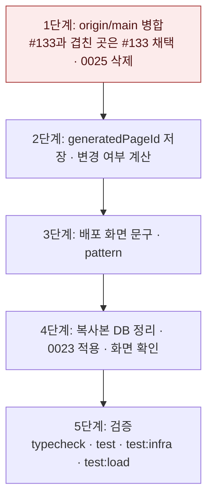

# 같은 주소 재배포와 편집 후 배포 변경 표시 — 구현 계획

## 바뀌는 파일

| 파일 | 무엇을 |
|---|---|
| `packages/database/src/documents/publishing.ts` | `DeploymentDoc.generatedPageId` |
| `services/backend/src/modules/publishing/service.ts` | `publish`가 실린 판 id 저장 |
| `services/backend/src/modules/portfolios/service.ts` | `#summary` 변경 여부 계산 |
| `services/backend/src/modules/publishing/mongodb.integration.test.ts` | 변경 표시 · 옮겨지는 옛 주소 409 테스트 |
| `services/web/src/app/(app)/edit/[portfolioId]/deploy/page.tsx` · `DeployPanel.tsx` · `deploy-actions.ts` | 「지면 판」 문구 · `pattern` · 안내 문구 |

주소 소유(`publicSlug`), 마이그레이션, 방문 기록 조회, 부하 테스트 시드는 #133의 코드를 그대로 씁니다.

구현 중 이 표에서 벗어나면 같은 커밋에서 이 파일을 고친다.

## 작업 순서



## 가장 위험한 단계

**1단계 병합:** #133과 이 브랜치가 같은 파일(publishing · analytics 서비스, 마이그레이션 목록, 부하 테스트)을 다르게 고쳤습니다. 겹친 파일은 #133 쪽을 통째로 받고, 2 · 3단계의 변경만 다시 얹습니다. 되돌리기는 #133대로 주소를 바꾸지 않습니다.

## 검증

```bash
pnpm typecheck
pnpm test
pnpm test:infra
EXPRESSO_LOAD_TEST=1 pnpm --filter @expresso/backend test:load
```

화면: `http://refine.localhost:3201/edit/<id>/deploy`에서 v1 상태 확인 → 편집 화면에서 글 한 줄 저장 → 배포 화면 「다릅니다」 → 「v2 배포」 → 「같습니다」 → 버전 목록에서 v1 되돌리기 → 「다릅니다」.
