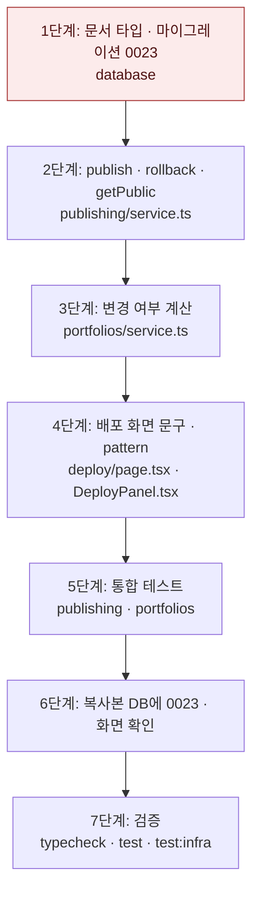

# 같은 주소 재배포와 편집 후 배포 변경 표시 — 구현 계획

## 바뀌는 파일

| 파일 | 무엇을 |
|---|---|
| `packages/database/src/mongodb-migrations/0023/migration.ts` (새 파일) | 주소 채우기 · 인덱스 교체 |
| `packages/database/src/mongo-migrations.ts` · `mongo-build.mjs` · `schema.test.ts` | 0023 등록 |
| `packages/database/src/documents/generation.ts` · `publishing.ts` | `PortfolioDoc.publishedSlug` · `DeploymentDoc.generatedPageId` |
| `services/backend/src/modules/publishing/service.ts` | `publish` · `rollback` · `getPublic` |
| `services/backend/src/modules/publishing/mongodb.integration.test.ts` | 재배포 · 주소 소유 · 옛 주소 이동 · 되돌리기 테스트 |
| `services/backend/src/modules/portfolios/service.ts` | `#summary` 변경 여부 계산 |
| `services/backend/src/modules/analytics/service.ts` | 공개 주소로 방문을 기록할 때 포트폴리오 주소 → 현재 배포로 찾기(같은 주소 배포 행이 여럿) |
| `services/backend/src/modules/portfolios/*.test.ts` (통합 테스트) | 변경 여부 테스트 |
| `services/web/src/app/(app)/edit/[portfolioId]/deploy/page.tsx` · `DeployPanel.tsx` · `deploy-actions.ts` | 「지면 판」 문구 · `pattern` · 안내 문구 |

구현 중 이 표에서 벗어나면 같은 커밋에서 이 파일을 고친다.

## 작업 순서



1. 문서 타입과 0023 — `schema.test.ts`가 0023까지 적용된 목록을 확인한다. 두 번 돌려도 같은지 본다.
2. 배포 서비스 — 같은 slug 재배포 · 다른 포트폴리오 409 · 경합 하나만 성공을 통합 테스트로 본다.
3. 변경 여부 — 배포 직후 false, 새 판 뒤 true, 재배포 뒤 false, 옛 배포(판 id 없음)의 시각 비교를 본다.
4. 배포 화면 — 문구와 콘솔 오류가 사라졌는지 화면에서 본다.
5. 통합 테스트 — `pnpm test:infra`로 돌린다.
6. 화면 확인 — `expresso_refine`에 `pnpm db:migrate`를 적용한다. 그 뒤 v1 → 편집 → v2 → 공개 주소 → v1 되돌리기를 확인한다.
7. 검증 — 아래 명령.

## 가장 위험한 단계

**1단계 마이그레이션:** 이미 배포된 DB의 unique 인덱스를 지웁니다. `publishedSlug`를 채우기 전에 인덱스를 지우면, 그사이 다른 포트폴리오가 같은 주소를 잡을 수 있습니다. 그래서 순서는 채우기 → 포트폴리오 unique 인덱스 생성 → 배포 인덱스 교체입니다.
- 채우기 중 중복이 나오면 마이그레이션을 멈추고 메시지로 알립니다.
- 되돌리려면 `deployment_subdomain_idx`를 지우고 `deployment_subdomain_key`(unique)를 다시 만듭니다. 이 복구는 slug당 배포 행이 하나일 때만 됩니다.

## 검증

```bash
pnpm typecheck
pnpm test
pnpm test:infra
```

화면: `http://refine.localhost:3201/edit/<id>/deploy`에서 v1 상태 확인 → 편집 화면에서 글 한 줄 저장 → 배포 화면 「다릅니다」 → 「v2 배포」 → `/site/<slug>` 반영 → 버전 목록에서 v1 되돌리기.
