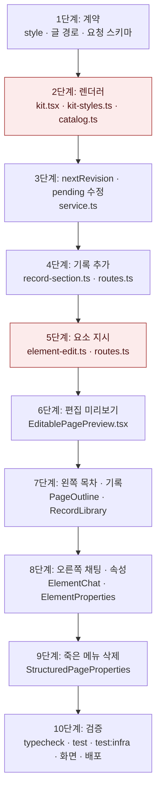

# 다듬기 화면 — 구현 계획

## 바뀌는 파일

| 파일 | 무엇을 |
|---|---|
| `packages/contracts/src/structured-portfolio.ts` | style 스키마 · 부분 표 · 글 경로 표 · 요청 스키마 |
| `packages/contracts/src/structured-portfolio.test.ts` (새 파일 또는 기존 테스트) | 경로 표 · style 검사 테스트 |
| `packages/portfolio-renderer/src/catalog.ts` | leaf `style` prop · `parts` · 선택지 이름 · `editableFields` |
| `packages/portfolio-renderer/src/kit.tsx` · `kit-styles.ts` | `data-xp-key` · `data-xp-part` · style 속성과 CSS |
| `packages/portfolio-renderer/src/kit.test.ts` | 표시 속성 · style CSS · 카탈로그와 계약 일치 테스트 |
| `services/backend/src/modules/page/service.ts` | `nextRevision` · `instructElement` · `addRecordSection` · size 단계 검사 |
| `services/backend/src/modules/page/element-edit.ts` (새 파일) | 요소 지시 프롬프트 · 출력 스키마 · check |
| `services/backend/src/modules/page/record-section.ts` (새 파일) | 기록 → 섹션 (AI · 규칙) |
| `services/backend/src/modules/page/routes.ts` | 두 라우트 |
| `services/backend/src/modules/page/*.test.ts` · `structured.mongo.integration.test.ts` | 단위 · 통합 테스트 |
| `services/backend/fixtures/ai/partial_edit/` · `page_fill/` (위치는 `fixture.ts` 설정을 따름) | 화면 확인용 fixture 출력 |
| `services/web/src/lib/api/endpoints.ts` | `page.instructElement` · `page.addSection` |
| `services/web/src/components/portfolio/EditablePagePreview.tsx` (새 파일) | 편집 문서 · 선택 스크립트 · 모션 끔 |
| `services/web/src/app/(app)/edit/[portfolioId]/Editor.tsx` | 구조화 지면 분기 · 선택 상태 · 좌우 패널 배치 |
| `.../edit/[portfolioId]/PageOutline.tsx` · `RecordLibrary.tsx` (새 파일) | 왼쪽 목차 · 기록 |
| `.../edit/[portfolioId]/ElementChat.tsx` · `ElementProperties.tsx` (새 파일) | 오른쪽 채팅 · 속성 |
| `.../edit/[portfolioId]/edit-actions.ts` · `page.module.css` | 서버 액션 · 스타일(토큰만) |
| `.../edit/[portfolioId]/StructuredPageProperties.tsx` · `.module.css` | 삭제 |

구현 중 이 표에서 벗어나면 같은 커밋에서 이 파일을 고친다.

## 작업 순서



1. 계약 — 경로 표로 만든 정규식이 옛 경로를 모두 받고, style 키가 타입별 부분만 받는 것을 테스트로 확인한다.
2. 렌더러 — 저장된 판 fixture를 다시 그려 `data-xp-*` 속성 외의 HTML 차이가 없는지 테스트로 확인한다. 카탈로그 leaf와 계약 leaf가 같은 집합인지 테스트한다.
3. `nextRevision` — pending 판에서 `editComposition`을 부른 결과에 `refinement`가 없음을 통합 테스트로 확인한다.
4. 기록 추가 — AI 없음(규칙)과 스크립트 클라이언트 두 경우로 새 판 · 연락처 앞 위치 · 409(중복)를 확인한다.
5. 요소 지시 — 스크립트 클라이언트가 근거 없는 수치를 낸 뒤 고친 칸만 다시 보내는 흐름과, 다른 요소가 그대로인 것을 확인한다. `fixes.test.ts`가 계속 통과해야 한다.
6. 편집 미리보기 — 내장 브라우저에서 클릭이 부모로 전달되고, 애니메이션 계산값이 `none`인지 확인한다.
7. 왼쪽 — 순서 변경 저장 후 미리보기 순서가 바뀌는지, 기록 추가 후 목차에 새 행이 생기는지 확인한다.
8. 오른쪽 — 글 · 스타일 · 선택지 저장과 AI 지시 · 되돌리기를 화면에서 확인한다.
9. 삭제 — 세 메뉴가 화면에 없는지 확인한다.
10. 검증 — 아래 명령과 화면 경로.

## 가장 위험한 단계

- **2단계 렌더러**: 모든 생성 지면의 HTML이 바뀌고 측정(`measure.ts`) · 다듬기 비교가 같은 HTML을 씁니다. 표시 속성만 더해지고 모양은 같아야 합니다. 깨지면 2단계 커밋을 되돌립니다. 이 커밋은 다른 단계와 분리해 둡니다.
- **5단계 요소 지시**: AI 출력 규칙(거절해 다시 쓰게 하지 않음)을 어기기 쉬운 자리입니다. `ai.complete`의 `check`만 쓰고, 호출하는 쪽에 재요청 루프를 두지 않습니다.

## 검증

```bash
pnpm typecheck
pnpm test
pnpm infra:up
pnpm test:infra
```

화면 확인 (웹 3201 · API 4201 · `refine.localhost` · 워커 `QUEUE_PREFIX=expresso-refine` · `AI_PROVIDER=fixture`, 체험 DB의 복사본):

1. `http://refine.localhost:3201/edit/<id>`에서 사례를 눌러 고르고, 오른쪽 속성에서 제목 색 · 크기를 바꿔 저장한다.
2. 인용을 골라 채팅으로 지시하고 바뀐 곳을 본 뒤 되돌린다.
3. 왼쪽 목차에서 사례 순서를 바꾸고, 기록 탭에서 기록 하나를 추가한다.
4. 「미리보기」 새 창, 배포 후 공개 지면에서 같은 결과를 확인하고 스크린샷을 남긴다.
