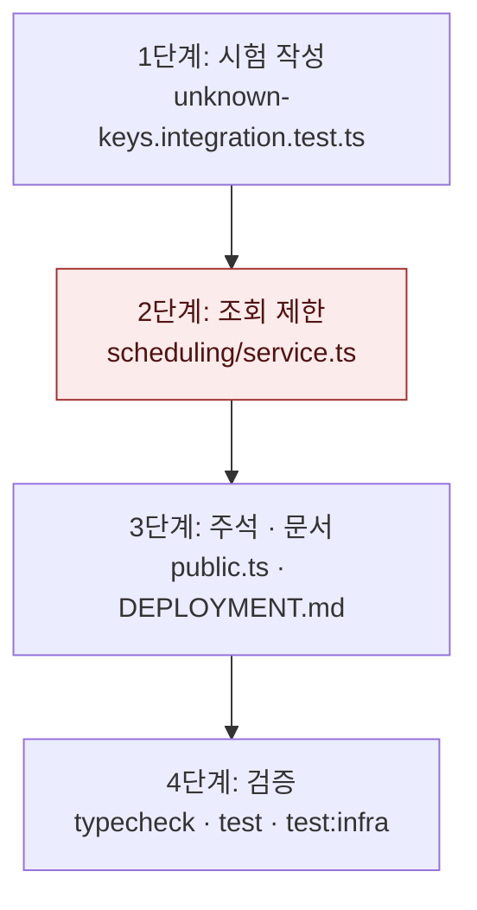

# 배포 중 새 예약 작업의 첫 실행 보존 — 구현 계획

## 바뀌는 파일

| 파일 | 무엇을 |
|---|---|
| `services/backend/src/modules/scheduling/service.ts` | 생성자에 `keys` 주입을 더하고 `scheduleDue`의 조회를 아는 키로 제한 |
| `services/backend/src/modules/scheduling/public.ts` | `SCHEDULED_JOB_KEYS` 주석을 바뀐 동작에 맞게 수정 |
| `services/backend/src/modules/scheduling/unknown-keys.integration.test.ts` (새 파일) | 옛 워커 재현과 새 워커 인계 시험 |
| `docs/operations/DEPLOYMENT.md` | 「실행」에 배포 뒤 `scheduled_job_runs` 확인과 적용 시점 추가 |

구현 중 이 표에서 벗어나면 같은 커밋에서 이 파일을 고친다.

## 작업 순서

1. 시험을 먼저 쓴다. `activity_collect`와 `proposal_briefing`을 뺀 `keys`로 만든 서비스가 `scheduleDue`를 돌린 뒤 두 키의 실행 0건, outbox 0건, `nextRunAt` 유지를 단언한다. 이어서 기본 서비스가 돌리면 `scheduledFor`가 원래 `nextRunAt`인 실행이 1건씩 생기는 것을 단언한다. 수정 전에는 서비스가 `keys`를 무시해, 옛 워커가 정의를 모두 예약하고 첫 단언에서 실패한다.
2. `service.ts`에 `keys`와 조회 조건을 더한다. 새 시험과 기존 `mongo.integration.test.ts`가 통과한다.
3. `public.ts` 주석과 `DEPLOYMENT.md`를 고친다.
4. 전체 검증을 돌린다.



## 가장 위험한 단계

2단계다. 조회 조건이 틀리면 운영의 모든 예약 작업이 멈춘다. 기존 시험 「schedules each due slot once」가 시드된 모든 정의가 예약되는 것을 확인한다. 깨지면 `service.ts`의 한 줄을 되돌린다.

## 검증

```
pnpm typecheck
pnpm test
pnpm test:infra
```

`pnpm test:infra` 출력에서 `unknown-keys.integration.test.ts`가 실행됐는지 확인한다.
