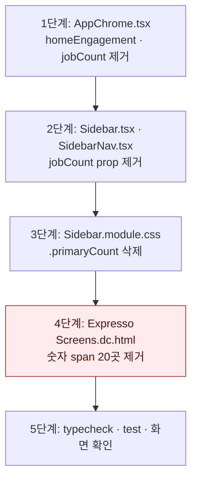

# Plan — 사이드바 공고 탐색 숫자 제거

## 바뀌는 파일 (모두 고침)

- `services/web/src/components/shell/AppChrome.tsx`
- `services/web/src/components/shell/Sidebar.tsx`
- `services/web/src/components/shell/SidebarNav.tsx`
- `services/web/src/components/shell/Sidebar.module.css`
- `docs/Expresso Screens.dc.html`

## 작업 순서



1. `AppSidebar`의 `Promise.all`에서 `homeEngagement`를 빼고 `jobCount` 전달을 지운다. 확인: `tsc`에서 `home` 미사용 오류가 없다.
2. 두 컴포넌트의 prop 선언과 전달, 숫자 `<span>`을 지운다.
3. 스타일 규칙 하나를 지운다. 확인: `grep primaryCount`가 비어 있다.
4. 가장 위험한 단계다. 정규식 치환이라 다른 곳을 건드릴 수 있다. 「공고 탐색」 라벨 바로 뒤의 `44` span만 대상으로 하고, 치환 전후 `git diff --stat`으로 줄 수가 20곳인지 본다. 되돌림은 `git checkout -- docs/Expresso\ Screens.dc.html`.
5. 검증 명령은 아래와 같다.

## 검증

```bash
pnpm typecheck
pnpm --filter @expresso/web test
```

화면은 `DEV_LOGIN`으로 `/home`과 `/jobs`를 열어 사이드바에 숫자가 없는지 본다.

## 자기 점검

- 깨질 수 있는 것: `Sidebar`를 직접 렌더하는 테스트가 `jobCount`를 넘기면 타입 오류가 난다. 단계 5에서 잡힌다(현재 `grep`으로는 없음).
