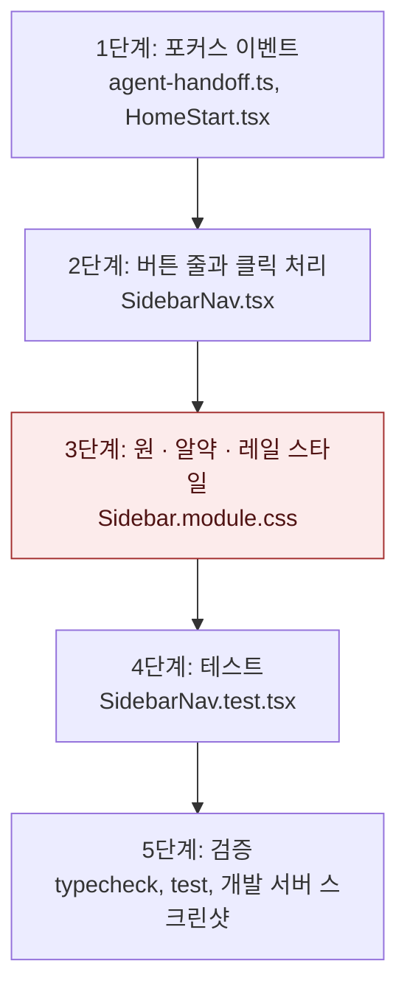

# 사이드바 「새 대화」 버튼 — 계획

## 바뀌는 파일

- 고침: `services/web/src/components/shell/SidebarNav.tsx` — 버튼 줄과 「새 대화」 링크, 클릭 처리
- 고침: `services/web/src/components/shell/Sidebar.module.css` — `.actions` · `.newChat` · `.newChatLabel`, 레일 규칙
- 고침: `services/web/src/features/agent-chat/agent-handoff.ts` — `AGENT_COMPOSER_FOCUS` 이벤트 이름
- 고침: `services/web/src/app/(app)/home/HomeStart.tsx` — 이벤트를 들어 입력창 포커스
- 고침: `services/web/src/components/shell/SidebarNav.test.tsx` — 링크 순서, 대화 중 클릭 · 홈 포커스 동작

## 작업 순서



## 가장 위험한 단계

3단계. 접힌 레일 규칙과 `.brew`의 기존 레일 폭 규칙이 새 줄 구조와 어긋나면 레일에서 버튼이 넘치거나 문구가 샌다. 개발 서버에서 펼침과 접힘을 모두 찍어 확인하고, 어긋나면 CSS 커밋만 되돌린다.

## 검증

```bash
pnpm --filter @expresso/web typecheck
pnpm --filter @expresso/web test
```
