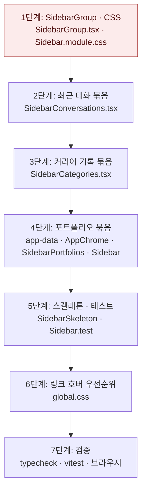

# 사이드바 포트폴리오 · 커리어 기록 묶음과 묶음별 접기 — 구현 계획

## 바뀌는 파일

| 파일 | 무엇을 |
|---|---|
| `services/web/src/components/shell/SidebarGroup.tsx` (새로) | 접히는 묶음 훅 · 뷰 · 묶음 |
| `services/web/src/components/shell/SidebarGroup.test.tsx` (새로) | 접기 · 저장 · 복원 · inert 테스트 |
| `services/web/src/components/shell/SidebarPortfolios.tsx` (새로) | 포트폴리오 · 제작 줄과 「모두 보기」 |
| `services/web/src/components/shell/sidebar-group-storage.ts` (새로) · `app/layout.tsx` | 첫 페인트 전 접힘 스크립트 |
| `services/web/src/components/shell/SidebarConversations.tsx` | 머리말을 `SidebarGroup`으로 |
| `services/web/src/components/shell/SidebarCategories.tsx` | `heading` 분기를 접히는 묶음으로, 이름 「커리어 기록」 |
| `services/web/src/components/shell/Sidebar.tsx` | 포트폴리오 · 카테고리 props와 묶음 배치 |
| `services/web/src/components/shell/AppChrome.tsx` · `lib/app-data.ts` | `recentPortfolios` 호출과 매핑 |
| `services/web/src/components/shell/SidebarSkeleton.tsx` | 묶음 이름 · 구조 맞춤 |
| `services/web/src/components/shell/Sidebar.module.css` | 묶음 토글 · 본문 접힘 · 레일 처리 |
| `services/web/src/components/shell/Sidebar.test.tsx` | 새 props와 묶음 확인 |
| `services/web/src/styles/global.css` | 전역 `a:hover` 우선순위를 `a:where(:hover)`로 낮춤 (구현 중 추가 요청) |
| `app/(app)/account/page.module.css` · `app/(app)/jobs/page.module.css` · `app/(app)/jobs/explore.module.css` · `app/(app)/library/library.module.css` | 흐린 링크의 호버 글자색을 자기 규칙에 적음 |

## 작업 순서

1. `SidebarGroup`과 CSS를 만든다 — 새 테스트가 접기 · 저장 · 복원 · inert를 확인한다.
2. 최근 대화를 `SidebarGroup`으로 옮긴다 — 기존 화면과 같게 보이고 머리말로 접힌다.
3. `SidebarCategories` 머리말을 접히는 묶음으로 바꾼다 — 기존 `SidebarCategories.test.tsx`가 통과한다.
4. `recentPortfolios`, `AppChrome` 매핑, `SidebarPortfolios`, `Sidebar` 배치를 되살린다 — 타입 검사가 통과한다.
5. 스켈레톤과 `Sidebar.test.tsx`를 맞춘다 — `vitest run src/components/shell`이 통과한다.
6. 전역 `a:hover` 우선순위를 낮추고, 전역 규칙에 기대던 흐린 링크에 호버 색을 적는다 — 「새 포트폴리오」 호버 글자가 흰색이고, 링크 감사 스크립트가 강조색 버튼 외에 호버 색 없는 링크를 찾지 않는다.
7. 로컬 웹에서 펼침 · 접힘 · 새로고침 · 레일 · 375px 서랍을 확인한다.



## 가장 위험한 단계

1단계. 본문 접힘 CSS가 레일 모드(`data-sidebar-collapsed`)의 줄 폭 전환, `GlideMenu` 하이라이트 위치, 포커스 링과 얽힌다. 깨지면 `.groupBody` 규칙만 빼서 펼친 상태로 되돌릴 수 있다. 접힘 기능만 사라지고 묶음은 그대로 보인다.

## 검증

```
pnpm --filter @expresso/web typecheck
pnpm --filter @expresso/web exec vitest run src/components/shell
```

화면: `/home`에서 세 묶음 확인 → 각 머리말 클릭 → 새로고침 → 사이드바 레일 접기 → 375px 서랍 열기.
