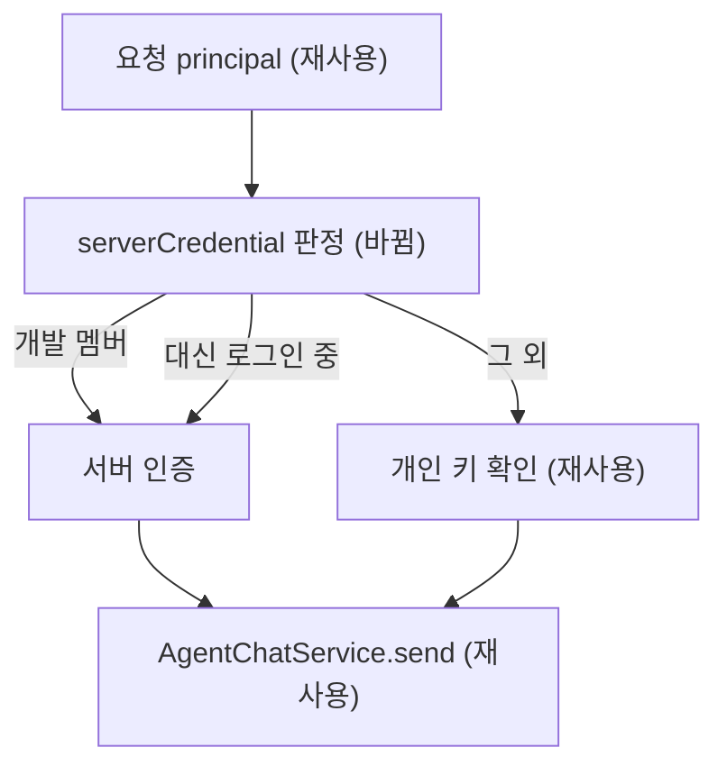

# Spec — 대신 로그인한 더미 계정의 에이전트 채팅 권한

## 요구사항

1. `GET /v1/agent/access`는 `principal.user.impersonation !== null`이면 `serverCredentialAllowed: true`를 낸다.
2. 같은 조건에서 `POST .../messages`와 `POST .../retry`는 개인 키 없이 202를 내고 `service.send` · `service.retry`에 `apiKey`를 넘기지 않는다.
3. 대신 로그인이 아니고 개발 멤버도 아니면 지금처럼 키가 없을 때 403이다.
4. 설정 화면 문구는 개발 멤버와 대신 로그인 계정 모두에 맞는 말이다.

## 설계

- 근거: 더미 계정은 스스로 로그인하지 못하고(`identity/service.ts` 로그인에서 `dummyKey` 거절), 대신 로그인 대상은 `dummyKey`가 있는 계정뿐이다. 따라서 `impersonation !== null`이 곧 "관리자가 접속한 더미 계정"이다.
- `agent-chat/routes.ts`의 `developer(userId)`를 `serverCredential(principal)`로 바꾼다 — `developerUserIds.includes(user.id) || user.impersonation !== null`. 세 자리 모두 이 함수를 쓴다.
- `AgentKeySettings.tsx`의 안내 문구를 "이 계정은 서버 Claude 인증으로 Sonnet을 사용합니다."로 바꾼다.
- 계약(`AgentChatAccessSchema`)은 바뀌지 않는다. 웹은 `serverCredentialAllowed`만 본다.

## 버린 대안

- 운영 `.env`에 더미 ID 추가: 더미를 개발 멤버로 표시하고, 서버마다 손으로 맞춰야 하며 새 더미가 생길 때마다 다시 적어야 한다.
- `user.dummyKey`를 principal에 싣기: 대신 로그인 외에는 더미 계정 세션이 없으므로 같은 뜻을 계약에 새 필드로 늘릴 뿐이다.

## 함정

- 대신 로그인 중 채팅 사용량은 더미 계정 앞으로 기록된다. 이번에 바꾸지 않는다.
