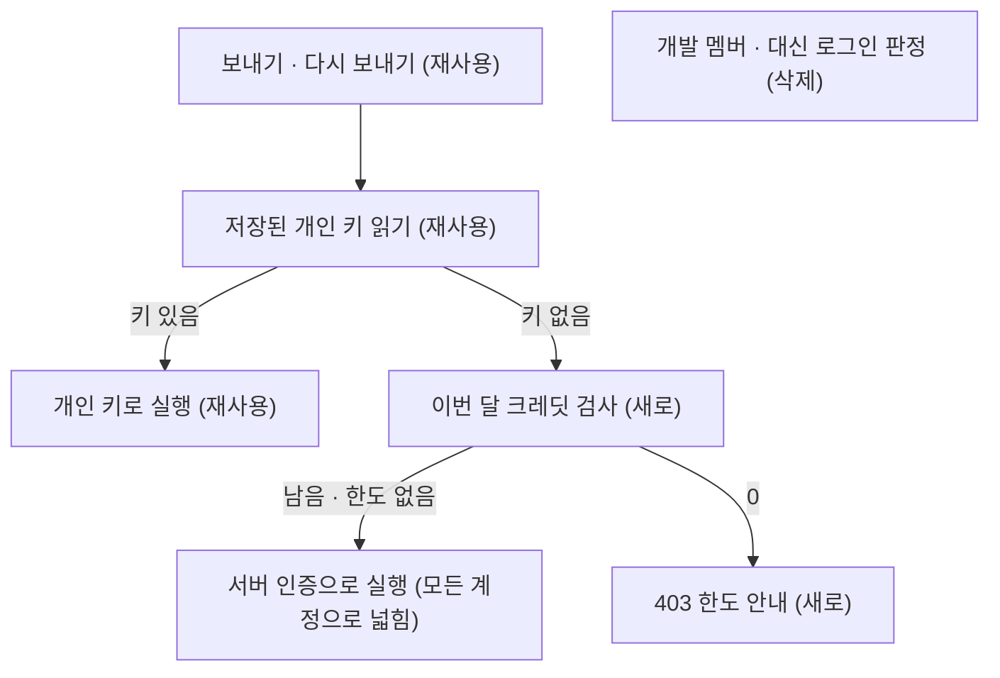

# Spec — 에이전트 채팅 전체 개방

## 요구사항

1. `POST /v1/agent/conversations/:id/messages`와 `POST .../retry`는 개인 키가 없어도 202를 낸다. 개인 키가 저장돼 있으면 그 키를 `service.send` · `service.retry`에 넘기고, 없으면 넘기지 않는다(서버 인증).
2. 서버 인증으로 도는 실행은 시작 전에 이번 달 크레딧을 본다. 남은 크레딧이 0이면 403과 한도 문장을 낸다. 개인 키로 도는 실행은 보지 않는다. 한도가 없는 요금제(`monthlyCredits` 없음)는 막지 않는다.
3. `GET /v1/agent/access`는 `{ enabled, consentRequired, apiKeyConfigured, creditsExhausted, model }`을 낸다. `serverCredentialAllowed`는 없앤다. `creditsExhausted`는 개인 키가 없고 남은 크레딧이 0일 때 참이다.
4. 웹의 보내기 조건은 `enabled && !consentRequired && !creditsExhausted`다. 키 등록을 요구하는 창과 안내는 지운다.
5. 설정의 「AI 채팅」 구획은 모든 계정에 키 입력란을 보이고, 키가 선택 사항임을 적는다.
6. `AGENT_CHAT_DEVELOPER_USER_IDS`와 `agentChatDeveloperUserIds`를 지운다.

## 설계

- 크레딧은 `EntitlementService.credits(userId)`로 읽는다. 능동 제안이 실행 전에 쓰는 것과 같은 자리다(`proposals/service.ts`). 요금제의 기능 표는 보지 않는다 — 채팅은 요금제로 가르는 기능이 아니다.
- 검사는 `AgentChatService.prepare`에 둔다. 보내기와 다시 보내기가 함께 지나는 자리다. `prepare`가 `apiKey` 유무를 받아 서버 인증일 때만 본다.
- 서비스는 `credits`를 생성자에서 받는다(`{ credits(userId): Promise<{ remaining: number | null }> }`). 주지 않으면 검사하지 않는다 — 테스트와 미리보기 서버가 그렇게 쓴다.
- `access`의 `creditsExhausted`는 라우트가 서비스의 `creditsExhausted(userId)`로 읽는다.
- 런타임의 개인 키 격리 실행(`runtime.ts`)과 키 저장(`credentials.ts`) · 키 라우트 · 키 입력 폼은 그대로다.
- 계약 `AgentChatAccessSchema`가 바뀐다. 웹과 API는 같은 배포에서 함께 나간다.

## 대안

- 개인 키 기능을 함께 없애기: 코드가 줄지만 저장된 키를 지워야 하고 되돌릴 수 없다. 요청은 여는 것이어서 이번에는 하지 않는다.
- 요금제 기능(`EntitlementCapability`)에 채팅을 더해 가르기: 요금제마다 켜고 끌 수 있지만 계약 · 요금제 문서 · 기본 표를 함께 바꿔야 한다. 지금은 가를 계획이 없다.

## 검증 기준

- 라우트 테스트: 키 없는 일반 계정이 202를 받고 `apiKey` 없이 서비스가 불린다. 키가 있으면 그 키가 넘어간다. `access`에 새 칸이 있다.
- 서비스 통합 테스트: 크레딧을 다 쓴 계정의 보내기와 다시 보내기가 403이고 대화가 바뀌지 않는다. 같은 계정이 개인 키로 보내면 실행이 시작된다.
- 실제 화면: 키 없는 계정으로 홈에서 말을 보내 답을 받는다. 설정의 「AI 채팅」 구획에 키 입력란과 선택 안내가 보인다.
