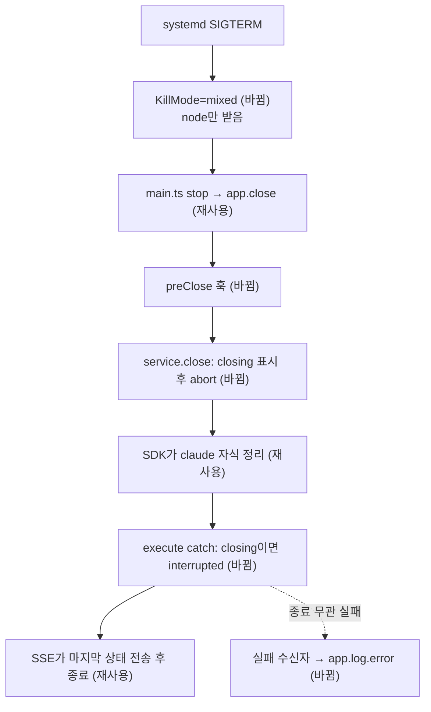

# 배포 재시작에 끊긴 에이전트 답변의 중단 표시 — 명세

## 요구사항

- [ ] `AgentChatService.close()`가 시작된 뒤 끝난 실행은 런타임이 어떤 오류로 끝나든 `run.status = "interrupted"`, `run.error = "서버 실행이 중단되었습니다. 다시 보내 주세요."`로 저장된다.
- [ ] `close()`와 무관한 런타임 오류는 지금처럼 `failed`와 기존 문구로 저장된다.
- [ ] 런타임 오류는 등록된 실패 수신자(`setRunFailureListener`)에게 오류 · 대화 id · 실행 id와 함께 전달되고, API는 이를 `app.log.error`로 남긴다. 종료 중단과 사용자 취소는 전달하지 않는다.
- [ ] API 종료 때 실행 중단이 HTTP 서버가 연결을 기다리기 전에 일어난다(Fastify `preClose`).
- [ ] `infra/systemd/expresso-api.service`가 `KillMode=mixed`를 갖는다.

## 설계

- **재사용**: 끊긴 실행 문구는 `owned()`가 이미 쓰는 "서버 실행이 중단되었습니다. 다시 보내 주세요."를 상수(`RUN_INTERRUPTED_ERROR`)로 올려 함께 쓴다. 웹 `AgentChat.tsx`의 `canRetry`와 백엔드 `retry()`는 이미 `interrupted`를 받는다. 계약 `AgentRunSchema.status`에도 있다.
- **service.ts**: `private closing = false`. `close()` 첫 줄에서 `closing = true`로 세운 뒤 컨트롤러를 abort한다. `execute()`의 `catch (error)`는 `closing`이면 위 문구와 `interrupted`, 아니면 기존 판정(`signal.aborted ? interrupted : failed`)과 기존 문구를 쓴다. `closing`도 `aborted`도 아니면 실패 수신자를 부른다. 수신자 등록은 `careerService.setExternalBodyListener`와 같은 세터 방식이다 — 서비스가 Fastify 앱보다 먼저 만들어지기 때문이다.
- **routes.ts**: `onClose` 훅을 `preClose`로 옮긴다. 실행이 `interrupted`로 바뀌면 SSE 루프(`snapshot.run?.status !== "running"`)가 마지막 상태를 보내고 끝나므로 서버 종료가 SSE 연결을 기다리지 않는다. 같은 자리에서 `service.setRunFailureListener((error, run) => app.log.error({ err: error, ...run }, "agent run failed"))`를 등록한다.
- **systemd**: `KillMode=mixed`면 SIGTERM은 node에만 가고, node가 끝나면 남은 프로세스에 SIGKILL이 간다(systemd.kill(5)). Agent SDK 자식은 node의 `abortController`로 먼저 정리된다.

## 버린 대안

- **문구만 바꾸기**: 상태가 `failed`로 남고, 실제 실패와 구분되지 않는다.
- **서비스 쪽 `closing` 표시만 두기**: `control-group`에서는 자식이 SIGTERM을 node와 동시에 받아 `close()`보다 먼저 실패할 수 있다. 이번 운영 사례가 그 순서였다.
- **종료 때 실행이 끝날 때까지 기다리기**: 실행 상한 600초가 systemd 대기 90초보다 길어 배포가 멈춘다.

## 함정

- `close()`는 SIGTERM 직후가 아니라 `app.close()` 안에서 불린다. 그 사이에 자식이 죽으면 `closing`이 아직 false다. 이 틈은 `KillMode=mixed`가 막는다 — 유닛 파일을 서버에 반영해야 효과가 완성된다.
- `catch` 뒤 `updateOne`은 `database.close()`보다 먼저 끝나야 한다. `close()`는 `this.tasks`를 기다리고, `main.ts`는 `app.close()` 뒤에 DB를 닫으므로 순서가 지켜진다.
- 테스트의 `afterAll`이 `service.close()`를 부르므로 `closing`이 다른 테스트에 새지 않게 서비스 인스턴스마다 둔다.

## 완료 기준

- `pnpm --filter @expresso/backend typecheck` 통과
- `pnpm test:infra` 중 `service.integration.test.ts`의 새 두 사례 통과
- 운영 반영 뒤 `systemctl show expresso-api -p KillMode` → `KillMode=mixed`
