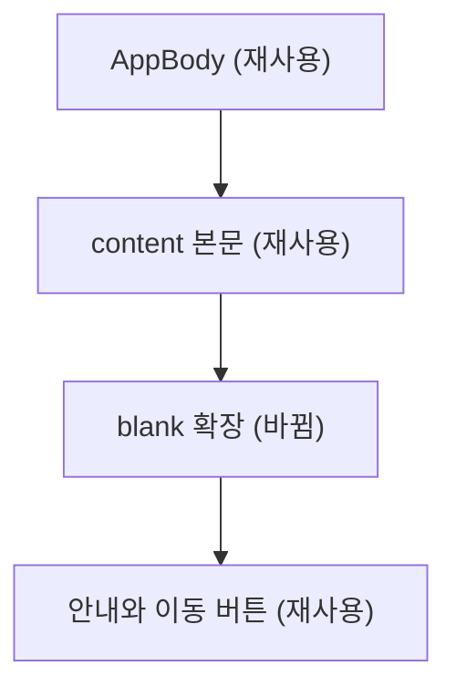

# 분석 빈 상태 본문 정렬 — 명세

## 요구사항
- 빈 상태는 본문 전체 폭과 남은 높이를 사용한다.
- 안내 묶음은 가로·세로 중앙에 배치하고 기존 여백과 스크롤을 적용한다.
- 모바일, 사이드바 접힘, 낮은 창에서 가로 넘침과 버튼 잘림이 없다.

## 설계
NothingPublished에서 Dashboard와 loading이 사용하는 styles.content를 재사용한다. 그 안의 styles.blank에 flex: 1과 min-width: 0을 지정한다. content가 스크롤과 화면별 여백을 담당하고 blank가 중앙 배치를 담당한다.

## 버린 대안
공용 AppBody 정렬 변경은 다른 화면과 드로어의 가로 배치를 바꾸므로 제외한다.

## 함정
blank의 최소 높이 때문에 낮은 화면에서는 content 안에서 스크롤해야 한다.

## 완료 기준
pnpm typecheck와 pnpm test 통과. 실제 로컬 API와 로그인한 분석 화면에서 데스크톱·모바일·접힌 사이드바·낮은 창을 확인한다. Reduce Motion은 공용 CSS 규칙을 코드로 확인한다.
