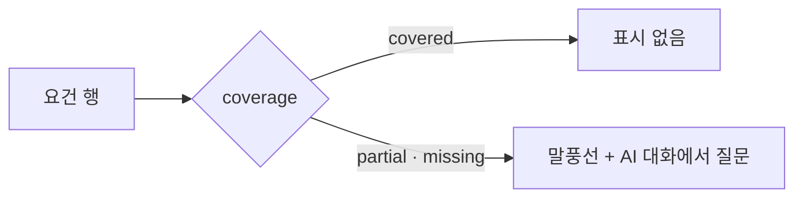

# 공고 분석 요건 행의 AI 대화 표시 — 명세

## 요구사항

1. `CoverageMap`은 요건 이름을 `.rowText`로 감싸고, `coverage !== "covered"`일 때 이름 아래 `.gapNote`에 `chat-teardrop-dots` 아이콘(13px)과 「AI 대화에서 질문」을 그린다. `aria-label` · `title`은 쓰지 않는다(글자가 그 역할).
2. `.gapNote`는 `.evidence`와 같은 크기 · 색(`--ex-text-2xs`, `--ex-fg-subtle`). 따로 있던 `gapSlot` 열을 빼고 행 그리드는 `16px minmax(0, 1fr) auto`.
   - 행마다 그리드가 따로라, 표시를 같은 줄 끝 열에 두면 덮인 행과 모자란 행의 근거 수 위치가 어긋난다. 그래서 이름 아래 줄에 둔다.

## 설계

## Open questions

없음.
